# Blazar inference benchmark

_Rendered 2026-11-22-postfix-full; blazar 0.34.3; power state of gateway rows: ac._

## Executive summary

- v0.9.5 prompt-cache prefill 20556 vs 20690 t/s cold
- b12606-cuda sweep C=4: C4: 493.9 t/s system (2x32768)
- ITL p99 5.48 ms vs ollama 3.99 ms (0.7x tighter)
- tool-call TTFT p50 14 ms vs ollama 284 ms (20.5x)
- adaptive reshape under sustained load: slots 2->16, 868.2->1831.0 t/s while serving, zero failed requests
- greedy determinism: direct 20/20 exact, gateway transparency 5/20 exact at temp 0 (divergence = multi-slot batching numerics, not translation drift)
- gateway cold boot 0.52 s
- cold TTFT 2079 ms vs ollama 1979 ms (1.0x)
- idle wake 27 ms (sleep) vs ollama 1753 ms (full reload)
- evict-ladder wake 1573 ms (full respawn still beats ollama's reload)

## Measured in this campaign

- blazar: 31 cell(s)
- cold-ollama: 1 cell(s)
- conc-blazar: 2 cell(s)
- conc-direct: 1 cell(s)
- conc-ollama: 1 cell(s)
- ctxcurve-blazar: 6 cell(s)
- ctxcurve-ollama: 3 cell(s)
- direct: 12 cell(s)
- features: 2 cell(s)
- greedy: 2 cell(s)
- greedy_gw: 1 cell(s)
- greedy_ollama: 1 cell(s)
- idle-blazar: 3 cell(s)
- idle-ollama: 1 cell(s)
- media-image: 4 cell(s)
- media-tts: 2 cell(s)
- media-tts-conc: 1 cell(s)
- media-video: 1 cell(s)
- media-whisper: 1 cell(s)
- ollama: 1 cell(s)
- ppl: 2 cell(s)
- quality: 2 cell(s)
- quality-direct: 2 cell(s)
- quality-ollama: 1 cell(s)
- reshape: 2 cell(s)
- tools: 2 cell(s)
- tools-ollama: 1 cell(s)

## Engine coverage

_Engine selection policy: latest installed version per engine kind._
| Engine | Kind | Lane | ok cells | err cells | Status |
|---|---|---|---:|---:|---|
| 2023.11.14-2 | piper | media (tts) | 2 | 0 | benchmarked |
| mlx-0.32.2 | mlx | text (direct venv + gateway) | 0 | 0 | model-format sweep: GGUF/safetensors campaign; this lane serves MLX-layout checkpoints (rerun with --model <mlx-row>) |
| v0.9.5 | mistralrs | text (direct + gateway) | 9 | 19 | benchmarked |
| master-1043-3be2378 | sdcpp | media | 5 | 0 | benchmarked |
| kokoro-1.0 | kokoro | media (tts) | 1 | 0 | benchmarked |
| litert-0.19.2 | openaihost | text (direct venv + gateway) | 0 | 0 | model-format sweep: GGUF/safetensors campaign; this lane serves .litertlm bundles (rerun with --model <litertlm-row>) |
| vllm-0.34.0 | vllm | text (gateway venv) | 0 | 0 | no cells in this campaign |
| b5907 | whisper | media | 1 | 0 | benchmarked |
| b12606-cuda | llamacpp | text (direct + gateway) | 42 | 0 | benchmarked |
| sglang-0.5.22 | sglang | text (direct venv + gateway) | 0 | 0 | no cells in this campaign |
| fork-AtomicBot-ai_atomic-llama-cpp-turboquant-8d935078-cuda | - | - | 0 | 0 | excluded: latest-per-kind policy: superseded by b12606-cuda |
| fork-GuideboardLabs_llama.cpp-sensenova-loop-a7f77a78-cuda | - | - | 0 | 0 | excluded: latest-per-kind policy: superseded by b12606-cuda |

## Test bed

| Component | Value |
|---|---|
| CPU | Intel Core i7-14650HX, 24 hardware threads |
| Discrete GPU | NVIDIA GeForce RTX 4070 Laptop, 8 GiB, driver 580.173.02 |
| Integrated GPU | Intel Graphics (RPL-S), Vulkan device |
| RAM | 16 GiB (13.3 GiB usable) |
| OS | Linux Mint 22.3, kernel 7.0.0-31-generic |
| Runtimes compared | blazar 0.34.3 gateway - inventory - kokoro-1.0 - llama.cpp b12606-cuda - mistral.rs v0.9.5 - ollama-host - piper 2023.11.14-2 - stable-diffusion.cpp master-1043-3be2378 - whisper.cpp b5907 |
| Model | af_heart, en_US-amy-medium, ggml-base, qwen-image-2.1-uncensored, qwen2.5-0.5b-instruct-q4_k_m.gguf, wan_2.1_comfyui_repackaged |

## Methodology

<details>
<summary><b>Measurement protocol (how every number on this page was produced)</b></summary>

- All lanes speak the OpenAI-compatible streaming API; tokens are counted from usage chunks (engine-injected at the gateway), never estimated from chunk counts.
- Decode throughput = (tokens - 1) / (last-token time - TTFT); medians over 5 runs after a warmup request.
- Inter-token latency (ITL) p50/p99 from per-chunk timestamps; TTFT p50/p90/p99 + stdev.
- Prefill: a token-targeted prompt (~512 tokens via engine /tokenize); run 1 is the cold (uncached) prefill, runs 2+ ride the prompt cache.
- Concurrency: N parallel streams x 128 generated tokens each (levels via --conc-sweep, per-row `C` column); system t/s = total tokens / wall clock; sum-stream t/s = sum of per-stream rates (sum >> system indicates serialization).
- Greedy parity: 20 fixed prompts, greedy sampling, 256 tokens; exact-match count and text-similarity ratio vs a same-engine reference run.
- Tool calls: 6 single-turn scenarios (3-tool set: weather/calculate/flights), temperature 0, max 192 tokens (call JSON must complete); scored on well-formed calls, correct function selection, valid JSON arguments with required keys, and a no-tool control for false positives; stream deltas accumulated per OpenAI spec.
- Gateway transparency: a second greedy lane through the blazar gateway with identical sampling; any divergence vs the direct lane isolates translation overhead.
- Perplexity: llama-perplexity on an offline ASCII corpus, ctx 2048.
- Cold-start parity: the model file's page cache is dropped (posix_fadvise DONTNEED) and the GPU asserted idle (<512 MiB) before every cold probe on every runtime - a cold load is disk-cold, not memory-warm.
- Cold TTFT = first-token latency of the cold probe itself (max_tokens 4, aligned num_ctx 16384 on both runtimes).
- ollama daemon boot is only measured with --ollama-service-restart (systemd restart, sudo password via BENCH_SUDO_PASSWORD env, stdin-only); without it the daemon stays warm and the row says so.
- Idle-wake: blazar's reaper sleeps the child at idle_sleep_secs (weights stay RAM-resident, VRAM released) - wake TTFT is a sleep-wake; ollama's keep_alive expiry fully unloads - wake TTFT is a disk reload. The policy column names the semantic; both measured after the policy is observed via /api/ps.
- Long-context curve: per-ctx cells (blazar model_overrides ctx / ollama num_ctx) x 3-run decode suites; each ollama point evicts first so the runner respawns at that ctx.
- Sustained concurrency: sequential bursts of the parallel-stream lane (default 3 rounds); TTFT p99 aggregates every stream of every round.
- Every blazar row records the spawned engine's argv (slots/context shown in tables) and stamps blazar version, wall clock, 5-min load average, and AC/battery power state; GPU cells refuse to run on battery.
- Media lanes run in isolated sandbox daemons (same protocol as text blazar cells); the engine child spawns lazily, so each family's first request is the COLD number (spawn + weights + first artifact), labeled cold_request_s.
- Media TTFB = time to first BODY byte (first audio sample for streamed PCM, not response headers); buffered WAV TTFB equals its total by construction and the table says so.
- Video frame counts are container ground truth: the response webm is parsed for lacing-aware SimpleBlock counts and asserted against the Wan 4k+1 temporal grid (a mismatch is recorded loudly, never averaged away).
- The video scratch-gate probe sends one expected-rejected monster (duration 60s -> 960 aligned frames) and times the 400; the legit 5-frame pass rides the same warm child, so axis-row vs probe deltas price the gate itself.
- Media cells stamp GPU-busy and RAM-available at entry instead of asserting an idle GPU: a warm child from the previous family is the normal media workflow, and the receipt carries the occupancy rather than hiding it.
- TTS RTF = synthesis wall / audio seconds, audio duration parsed from the RIFF data-chunk length (not estimated from characters); whisper transcribes a WAV synthesized by the same campaign's piper voice, so the input is reproducible from the receipt.
- Image quality stamps are PIL-gated luma-domain metrics (rms contrast = luma stddev, entropy in bits, unique colors on a 256x256 downsample); when PIL is absent the row carries an honest 'skipped' note instead of a fake number, and one audit PNG per steps point is saved beside the cells for offline re-measurement.
- TTS concurrency probe: N parallel streamed-PCM requests through one sandboxed gateway; wall clock vs sum of per-stream totals yields an efficiency ratio (sum/wall ~ 1 means serialized, -> N means perfectly parallel), and the probe fails loudly if any stream errors or truncates.
- Adaptive reshape: sustained 8 concurrent streams (adoption needs a 60 s saturation streak plus a graceful drain); the child engine -np is polled from /proc every 2 s to prove the reshape landed; throughput and TTFT p50 are compared before vs after the slot transition; a dropped request anywhere fails the lane.
- Time-to-first-byte (TTFB) is stamped when the first response byte arrives on every stream; under burst arrival its per-level median upper-bounds queue wait (dashed curves on the concurrency tail-latency chart). Receipts from harness versions before TTFB capture omit the field and those curves.
- Concurrency cells sample GPU memory, GPU board power, and host CPU busy (delta /proc/stat, busy = total - idle - iowait) every 1.2 s alongside the load; the resource-vs-concurrency charts read those per-cell peaks. Legacy receipts without sampler folds omit the power chart.
- Quality suites: seven deterministic-checker suites (arithmetic reasoning, verifiable instruction following, code with executed tests, JSON schema, needle-in-haystack, multilingual, refusal/benign) on a seeded task generator (default seed 1337, --quality-seed) - the identical task set runs through blazar, the direct engine, and ollama, so pass-rate deltas isolate the gateway. Hybrid reasoning models are pinned to direct answers (enable_thinking=false on the OpenAI-compatible path, think=false on ollama's native /api/chat) so a lane measures task ability, not how much of the token budget the <think> block consumed. A parallel fast-subset probe (default C=4) rides the same daemon session; per-task prompts, raw excerpts, and checker verdicts land in cells.jsonl. Embed triples compare only within one engine (vector spaces are not cross-engine comparable). A config knob whose pass rate drops more than 2.0 pp vs default is flagged by the QC gate regardless of its speed win.

</details>

## Results

### Single-stream decode (512-token prompt, 128 generated, median of 5)

<details>
<summary><b>Receipt table - single-stream decode</b></summary>

| Runtime | slots x ctx | decode t/s | tok/s per W (net) | TTFT p50 ms | TTFT p99 ms | ITL p50 ms | ITL p99 ms | prefill cold t/s | prefill cached t/s | GPU peak MiB | GPU power W |
|---|---|---:|---:|---:|---:|---:|---:|---:|---:|---:|---:|---:|
| blazar gateway - llama.cpp b12606-cuda | 2x32768 | 330.8 | 25.282 | 8.0 | 10.4 | 3.1 | 4.4 | 18888.7 | 73216.2 | 1266 | 54.4 |
| blazar gateway - llama.cpp b12606-cuda (single-stream) | 1x16384 | 326.8 | 29.913 | 7.8 | 10.3 | 3.0 | 4.1 | 19148.3 | 69374.3 | 1056 | 54.7 |
| blazar gateway - llama.cpp b12606-cuda (cont_batching_off) | 2x32768 | 326.4 | 28.721 | 7.5 | 9.5 | 3.1 | 4.2 | 17737.6 | 66825.6 | 1266 | 54.6 |
| blazar gateway - llama.cpp b12606-cuda (fa_on) | 2x32768 | 335.5 | 30.044 | 7.7 | 10.5 | 3.0 | 4.0 | 18880.3 | 74820.8 | 1266 | 55.0 |
| blazar gateway - llama.cpp b12606-cuda (fa_off) | 2x32768 | 326.9 | 32.957 | 8.8 | 14.0 | 3.1 | 4.5 | 12423.0 | 72284.2 | 1922 | 54.7 |
| blazar gateway - llama.cpp b12606-cuda (kv_unified_on) | 2x32768 | 322.0 | 29.522 | 8.0 | 11.5 | 3.0 | 4.5 | 18820.6 | 74536.1 | 1266 | 54.4 |
| blazar gateway - llama.cpp b12606-cuda (kv_unified_off) | 2x32768 | 330.5 | 31.476 | 9.1 | 10.5 | 3.0 | 4.4 | 18794.8 | 72929.4 | 1248 | 54.9 |
| blazar gateway - llama.cpp b12606-cuda (swa_full_on) | 2x32768 | 327.5 | 30.637 | 8.0 | 10.3 | 3.0 | 4.5 | 17928.6 | 66514.2 | 1266 | 54.8 |
| blazar gateway - llama.cpp b12606-cuda (no_kv_offload_on) | 2x32768 | 192.8 | 13.617 | 9.4 | 13.9 | 5.1 | 6.7 | 14495.0 | 52536.2 | 856 | 44.0 |
| blazar gateway - llama.cpp b12606-cuda (cache_q8_q8_0) | 2x32768 | 306.5 | 19.954 | 7.7 | 12.1 | 3.3 | 4.7 | 17728.1 | 65175.8 | 1100 | 54.0 |
| blazar gateway - llama.cpp b12606-cuda (ctx_checkpoints_4) | 2x32768 | 325.8 | 31.456 | 7.7 | 10.4 | 3.1 | 4.4 | 18411.6 | 68548.1 | 1266 | 54.7 |
| blazar gateway - llama.cpp b12606-cuda (spec_off) | 2x32768 | 346.9 | 28.234 | 7.4 | 11.2 | 2.9 | 4.1 | 18381.7 | 82902.9 | 1266 | 54.9 |
| blazar gateway - llama.cpp b12606-cuda (deterministic_on) | 1x16384 | 331.9 | 32.493 | 7.4 | 10.3 | 3.0 | 4.2 | 18387.6 | 79680.3 | 1056 | 54.4 |
| blazar gateway - llama.cpp b12606-cuda (mmproj_offload_off) | 2x32768 | 320.6 | 30.425 | 8.4 | 10.9 | 3.1 | 4.3 | 18713.3 | 75692.3 | 1266 | 54.2 |
| blazar gateway - llama.cpp b12606-cuda (threads_batch_8) | 2x32768 | 324.2 | 26.689 | 7.4 | 9.5 | 3.1 | 4.5 | 18931.7 | 74418.9 | 1266 | 54.5 |
| blazar gateway - llama.cpp b12606-cuda (cache_reuse_256) | 2x32768 | 317.8 | 29.097 | 7.2 | 9.9 | 3.1 | 4.5 | 18227.3 | 73718.4 | 1266 | 54.0 |
| blazar gateway - llama.cpp b12606-cuda (kv_unified_per_slot_4096) | 2x32768 | 341.1 | 33.404 | 8.0 | 11.2 | 3.0 | 4.5 | 18797.7 | 74244.3 | 1266 | 54.6 |
| blazar gateway - llama.cpp b12606-cuda (conc_default) | 2x32768 | - | - | - | - | - | 5.4 | - | - | 1268 | 54.6 |
| blazar gateway - llama.cpp b12606-cuda (adaptive_slots_off) | 2x32768 | - | - | - | - | - | 5.0 | - | - | 1268 | 54.7 |
| blazar gateway - llama.cpp b12606-cuda (poll_50) | 2x32768 | - | - | - | - | - | 5.5 | - | - | 1268 | 54.6 |
| blazar gateway - mistral.rs v0.9.5 (paged_attn_off) | engine-scheduled | 245.6 | 13.539 | 10.6 | 18.5 | 4.2 | 5.5 | 20690.1 | 20555.5 | 806 | 51.3 |
| direct engine - llama.cpp b12606-cuda | 1x16384 | 338.0 | 19.626 | 6.1 | 10.4 | 2.9 | 3.9 | 20010.9 | 91594.3 | 788 | 54.9 |
| ollama 0.33.3 - qwen2.5:0.5b (t/s NOT comparable - matrix model differs) | service | 341.0 | 47.587 | 8.9 | 11.8 | 3.0 | 4.0 | 5130.6 | 123427.2 | 726 | 53.7 |

</details>

### Single-stream decode throughput (chart)

<p align="center">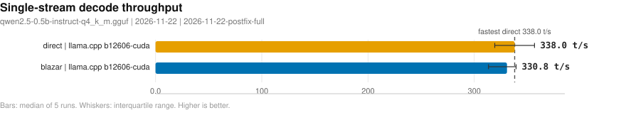</p>

_Median decode t/s per runtime and engine; whiskers span the interquartile range of the 5 runs; the dashed line marks the fastest direct engine. Higher is better. Source: 2026-11-22-postfix-full/cells.jsonl._

### Gateway overhead (chart)

<p align="center">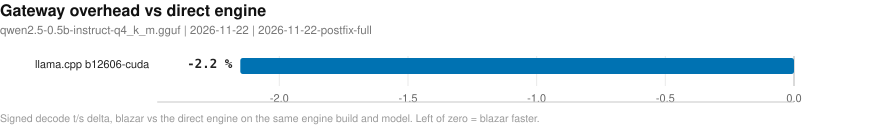</p>

_Decode t/s delta of routing through blazar relative to driving the same engine build directly; left of zero means the gateway path won. Source: 2026-11-22-postfix-full/cells.jsonl._

### Concurrency (4 parallel streams x 128 tokens)

<details>
<summary><b>Receipt table - concurrency lanes</b></summary>

| Runtime | slots | ok streams | rounds | system t/s | sum-stream t/s | wall s | TTFT max ms | TTFT p99 ms | ITL p99 ms |
|---|---|---:|---:|---:|---:|---:|---:|---:|---:|
| blazar gateway - llama.cpp b12606-cuda | 2x32768 | 12 of 3x4 | 3 | 493.9 | 3218.4 | 2.46 | 474 | 473 | 5.7 |
| blazar gateway - mistral.rs v0.9.5 | engine-scheduled | 12 of 3x4 | 3 | 0.0 | 0.0 | 0.03 | 10 | 10 | - |
| direct engine - llama.cpp b12606-cuda | 4 | 12 of 3x4 | 3 | 534.1 | 2371.2 | 1.82 | 28 | 28 | 8.1 |
| ollama - qwen2.5:0.5b | service | 12 of 3x4 | 3 | 179.9 | 4091.8 | 4.39 | 2752 | 2722 | 4.0 |

_sum-stream >> system t/s means streams serialize on one slot; roughly equal means genuinely parallel._

</details>

### Concurrency scaling (chart)

<p align="center">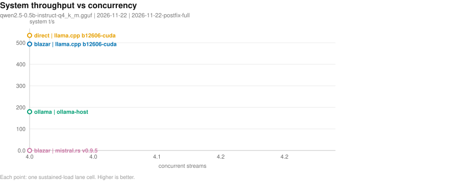</p>

_Aggregate system tokens/s as parallel streams are added; flat-to-rising means the scheduler keeps the device saturated. Higher is better. Source: 2026-11-22-postfix-full/cells.jsonl._

### Concurrency tail latency (chart)

<p align="center">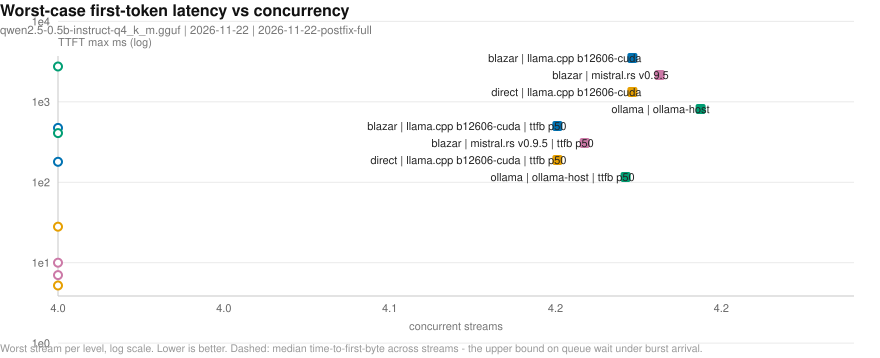</p>

_Worst-case first-token wait per stream as concurrency rises (log scale) - the tail the scheduler must bound. Lower is better. Dashed curves carry the median time-to-first-byte, which upper-bounds queue wait under burst arrival. Source: 2026-11-22-postfix-full/cells.jsonl._

### Resource cost and reliability vs concurrency

<p align="center">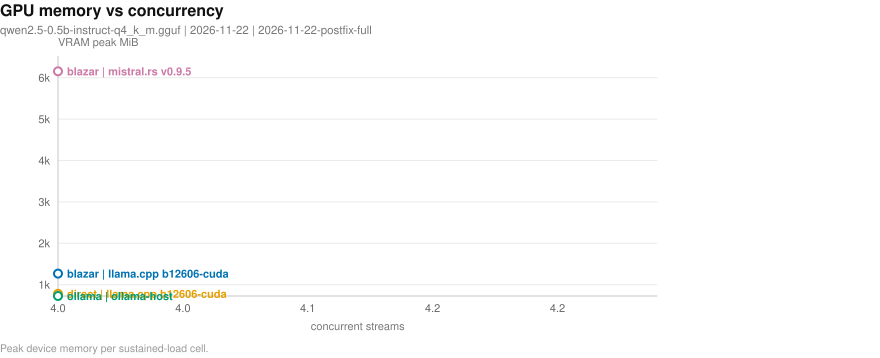</p>

_Peak VRAM footprint as parallel streams (and their KV caches) stack up. Source: 2026-11-22-postfix-full/cells.jsonl._

<p align="center">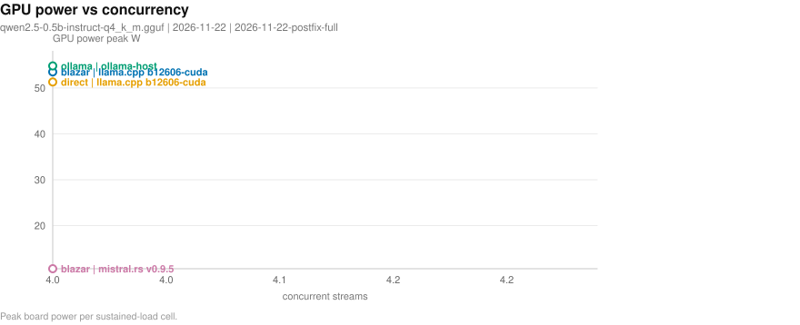</p>

_Peak GPU board power per concurrency level - the energy price of keeping the device saturated. Source: 2026-11-22-postfix-full/cells.jsonl._

### Concurrency frontier verdicts

- blazar gateway - llama.cpp b12606-cuda: 1 level(s) measured - insufficient levels for a saturation verdict.
- blazar gateway - mistral.rs v0.9.5: 1 level(s) measured - insufficient levels for a saturation verdict.
- direct engine - llama.cpp b12606-cuda: 1 level(s) measured - insufficient levels for a saturation verdict.
- ollama - qwen2.5:0.5b: 1 level(s) measured - insufficient levels for a saturation verdict.

### Adaptive reshape under sustained load (no-lag proof)

<details>
<summary><b>Receipt table - adaptive reshape</b></summary>

| Runtime | reshape | slots | time to reshape s | req before/after | TTFT p50 before->after ms | sys t/s before->after | failed |
|---|---|---|---:|---:|---:|---:|---:|
| blazar gateway - llama.cpp b12606-cuda | yes | 2->16 | 32 | 289/5113 | 404->46 | 868->1831 | 0 |
| blazar gateway - mistral.rs v0.9.5 | n/a | skipped: adaptive reshape is a llamacpp-lane mechanism; this engine's child exposes no slot shape (-np) to observe or adopt | - | - | - | - | - |

<details><summary>daemon tail (slots/reshape) - llama.cpp b12606-cuda</summary>

```
2026-11-22T17:31:27.464260Z  INFO evict: terminating child and releasing the slot model="qwen2.5-0.5b-instruct" pid=994429
2026-11-22T17:31:27.464260Z  INFO evict: terminating child and releasing the slot model="qwen2.5-0.5b-instruct" pid=994429
```

</details>

</details>

### Perplexity

<details>
<summary><b>Receipt table - perplexity</b></summary>

| Engine | KV rung | perplexity (ctx 2048, offline ASCII corpus) | ppl tool |
|---|---|---:|---|
| llama.cpp b12606-cuda | f16 | 33.55 +/- 1.90 | own |
| mistral.rs v0.9.5 | f16 | 33.55 +/- 1.90 | borrowed (llama-b12606) |

</details>

### Greedy parity and gateway transparency (20 prompts, 256 tokens)

<details>
<summary><b>Receipt table - greedy parity</b></summary>

| Comparison | exact / total | ratio mean | ratio min |
|---|---:|---:|---:|
| llama.cpp b12606-cuda vs same-engine reference (direct) | 20/20 | 1.000 | 1.000 |
| mistral.rs v0.9.5 vs same-engine reference (direct) | 2/20 | 0.193 | 0.001 |
| llama.cpp b12606-cuda through blazar gateway vs direct | 5/20 | 0.485 | 0.027 |
| ollama (qwen2.5:0.5b) run-to-run, temp 0 | 15/20 | 0.846 | 0.105 |

_Exact-match divergence across GPU backends is expected float nondeterminism (batch shape and backend kernels), not translation drift; bit-parity across runs requires single-slot decoding (blazar `deterministic = true` pins it)._

</details>

### Tool calls (single-turn selection + schema quality)

<details>
<summary><b>Receipt table - tool calls</b></summary>

| Runtime | scenarios | well-formed | selection | args valid | control FP | TTFT p50 ms |
|---|---:|---:|---:|---:|---|---:|
| blazar gateway - b12606-cuda | 6 | 5/6 | 5/5 | 5/5 | yes | 14 |
| blazar gateway - v0.9.5 | 6 | 0/6 | 0/5 | 0/5 | no | 3 |
| ollama - qwen3.5:9b | 6 | 4/6 | 4/5 | 4/5 | no | 284 |

</details>

### Quality suites (checker-verified, seeded, greedy)

- _quality lane: **ran** - 3 scored row(s); suites: code, instruct, multilingual, niah, reason, safety, schema_

<details>
<summary><b>Receipt table - quality suites</b></summary>

| Runtime | Engine | config | reason | instruct | code | schema | niah | multilingual | safety | overall | conc quality |
|---|---|---|---:|---:|---:|---:|---:|---:|---:|---:|---:|
| direct | llama.cpp b12606-cuda | direct | 0/12 | 4/10 | 2/5 | 5/6 | 6/6 | 3/8 | 12/12 | 32/59 | - |
| blazar | llama.cpp b12606-cuda | default | 0/12 | 4/10 | 2/5 | 6/6 | 6/6 | 3/8 | 12/12 | 33/59 | 6/18 @C=4 |
| ollama | ollama daemon | ollama | 0/12 | 2/10 | 4/5 | 6/6 | 6/6 | 3/8 | 12/12 | 33/59 | 6/18 @C=4 |

</details>

- Gateway parity on llama.cpp b12606-cuda: overall pass 54.2% direct vs 55.9% through blazar (+1.7 pp) on the identical seeded task set.
- Quality under load on llama.cpp b12606-cuda: 6/18 at C=4 (33.3%) vs 33.3% serial on the same fast subset - held.
- ollama reference: 55.9% overall on qwen2.5:0.5b (same-family build, not the campaign checkpoint).

### Quality suites (chart)

<p align="center">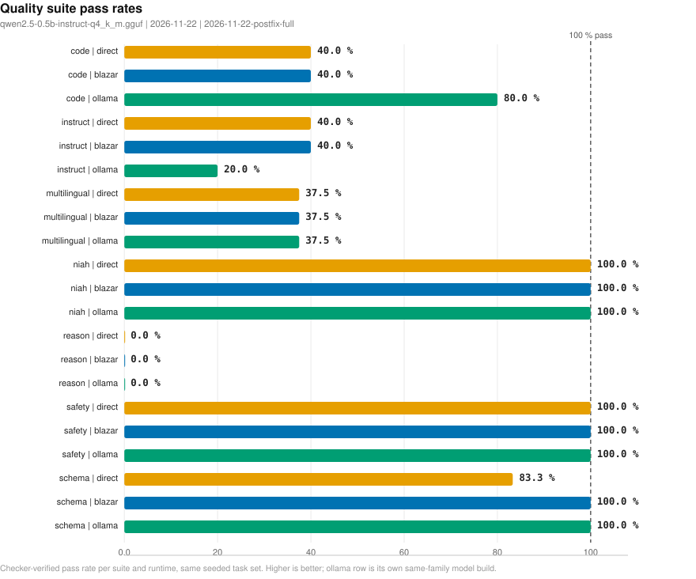</p>

_Deterministic-checker pass rates per suite (reasoning, instruction following, code, schema, needle-in-haystack, multilingual, safety) across runtimes on the identical seeded task set. Source: 2026-11-22-postfix-full/cells.jsonl._

### Gateway quality parity (chart)

<p align="center">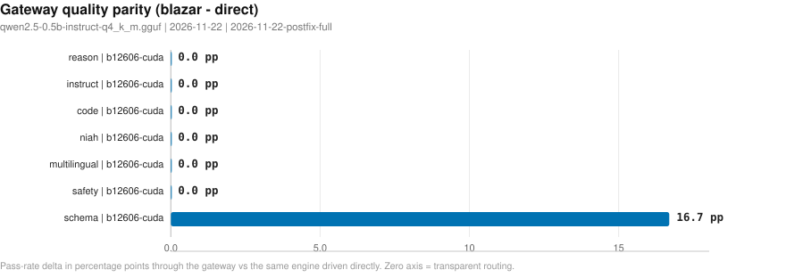</p>

_Per-suite pass-rate delta of routing through blazar vs the same engine build driven directly; bars hugging the zero axis are the gateway being output-transparent. Source: 2026-11-22-postfix-full/cells.jsonl._

### Optimization axes (ctx 4096, single stream)

<details>
<summary><b>Receipt table - optimization axes</b></summary>

| Engine | axis | setting | decode t/s | delta vs dense | prefill cold t/s | delta |
|---|---|---|---:|---:|---:|---:|
| llama.cpp b12606-cuda | kv | q8_0 | 325.7 | -33.3 | 19903.9 | 441.0 |
| llama.cpp b12606-cuda | pa | on | 355.1 | -3.8 | 20499.7 | 1036.7 |
| llama.cpp b12606-cuda | spec | ngram-simple | 333.6 | -25.3 | 19642.4 | 179.5 |
| mistral.rs v0.9.5 | pa | off | 245.7 | - | 15974.6 | - |

</details>

### Gateway config knobs (on/off vs default profile)

<details>
<summary><b>Receipt table - config knob A/B</b></summary>

| Engine | config | decode t/s | decode delta% | ttft p50 ms | ttft delta% | GPU peak MiB | GPU delta | output vs default |
|---|---|---:|---:|---:|---:|---:|---:|:-:|
| llama.cpp b12606-cuda | single-stream | 326.8 | -1.2% | 8 | -1.8% | 1056 | -210 | DRIFT |
| llama.cpp b12606-cuda | cont_batching_off | 326.4 | -1.3% | 7 | -6.5% | 1266 | +0 | same |
| llama.cpp b12606-cuda | fa_on | 335.5 | +1.4% | 8 | -3.4% | 1266 | +0 | same |
| llama.cpp b12606-cuda | fa_off | 326.9 | -1.2% | 9 | +10.3% | 1922 | +656 | same |
| llama.cpp b12606-cuda | kv_unified_on | 322.0 | -2.6% | 8 | -0.2% | 1266 | +0 | same |
| llama.cpp b12606-cuda | kv_unified_off | 330.5 | -0.1% | 9 | +14.2% | 1248 | -18 | DRIFT |
| llama.cpp b12606-cuda | swa_full_on | 327.5 | -1.0% | 8 | +0.1% | 1266 | +0 | same |
| llama.cpp b12606-cuda | no_kv_offload_on | 192.8 | -41.7% | 9 | +17.7% | 856 | -410 | same |
| llama.cpp b12606-cuda | cache_q8_q8_0 | 306.5 | -7.3% | 8 | -3.5% | 1100 | -166 | DRIFT |
| llama.cpp b12606-cuda | ctx_checkpoints_4 | 325.8 | -1.5% | 8 | -3.7% | 1266 | +0 | same |
| llama.cpp b12606-cuda | spec_off | 346.9 | +4.9% | 7 | -7.5% | 1266 | +0 | same |
| llama.cpp b12606-cuda | deterministic_on | 331.9 | +0.3% | 7 | -7.7% | 1056 | -210 | same |
| llama.cpp b12606-cuda | mmproj_offload_off | 320.6 | -3.1% | 8 | +5.2% | 1266 | +0 | same |
| llama.cpp b12606-cuda | threads_batch_8 | 324.2 | -2.0% | 7 | -6.7% | 1266 | +0 | same |
| llama.cpp b12606-cuda | cache_reuse_256 | 317.8 | -3.9% | 7 | -9.4% | 1266 | +0 | same |
| llama.cpp b12606-cuda | kv_unified_per_slot_4096 | 341.1 | +3.1% | 8 | -0.4% | 1266 | +0 | same |
| mistral.rs v0.9.5 | paged_attn_off | 245.6 | - | 11 | - | 806 | - | - |

</details>

### Gateway scheduler knobs under concurrent load (C=8 bursts)

<details>
<summary><b>Receipt table - conc lane A/B</b></summary>

| Engine | config | sys tok/s | sys delta% | ttft p99 ms | ttft delta% | GPU peak MiB | GPU delta | errs |
|---|---|---:|---:|---:|---:|---:|---:|---:|
| llama.cpp b12606-cuda | conc_default | 344.8 | +0.0% | 2921 | +0.0% | 1268 | +0 | 0 |
| llama.cpp b12606-cuda | adaptive_slots_off | 344.2 | -0.2% | 2682 | -8.2% | 1268 | +0 | 0 |
| llama.cpp b12606-cuda | poll_50 | 325.6 | -5.6% | 3006 | +2.9% | 1268 | +0 | 0 |

</details>

### Engine capability matrix

<details>
<summary><b>Receipt table - capability matrix</b></summary>

| Capability | llama.cpp b12606-cuda | mistral.rs v0.9.5 |
|---|---:|---:|
| anthropic-api | no | yes |
| ctx-override | yes | yes |
| embeddings | yes | no |
| grammar-gbnf | yes | no |
| json-schema | yes | yes |
| kv-quant | yes | yes |
| lora-adapter | yes | yes |
| metrics-endpoint | yes | yes |
| paged-attn | yes | yes |
| parallel-np | yes | yes |
| quant-on-load | yes | yes |
| rerank | yes | no |
| slots-sessions | yes | no |
| spec-decode | yes | yes |
| tokenize-endpoint | yes | no |
| vision-mmproj | yes | yes |

</details>

### Cold start and idle wake (lifecycle)

<p align="center">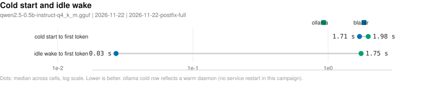</p>

_Seconds to first token after a cold start (page cache dropped) and after idle-policy expiry; blazar keeps weights resident while ollama reloads from disk. Warm-daemon ollama caveat applies. Lower is better. Source: 2026-11-22-postfix-full/cells.jsonl._

_Every cold probe runs page-cache-dropped and GPU-idle-asserted on both runtimes; ollama rows without --ollama-service-restart leave the daemon warm (noted on the chart when it applies). blazar sleeps with weights in RAM (wake = resume); ollama unloads at keep_alive expiry (wake = full disk reload). Policies differ by design - each dot measures its own runtime's idle path after the policy verifiably fired. Per-run detail and per-config rows: the campaign's cells.jsonl._

### Long-context degradation curve

<p align="center">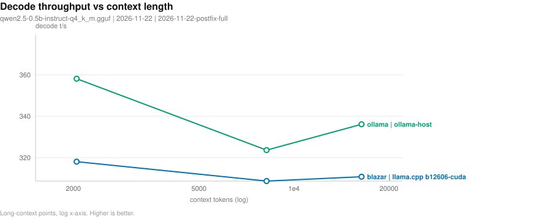</p>

_Single-stream decode t/s as prompt context grows (log x-axis) - KV-cache pressure made visible. Source: 2026-11-22-postfix-full/cells.jsonl._

<p align="center">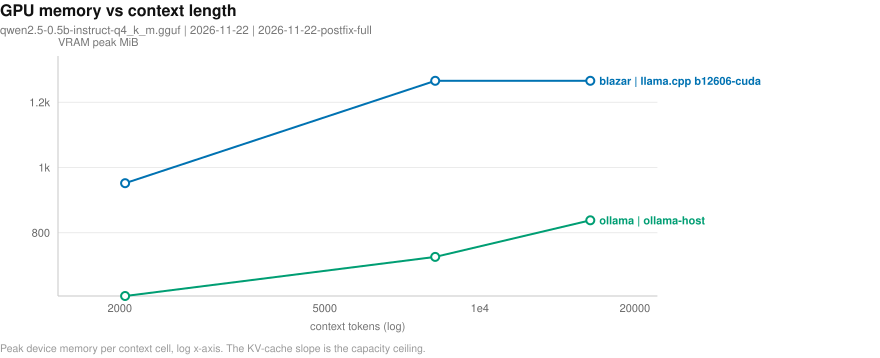</p>

_Peak VRAM as prompt context grows (log x-axis) - the KV-cache slope that sets the usable context ceiling. Source: 2026-11-22-postfix-full/cells.jsonl._

### Media lanes (image / video / TTS / whisper)

<details>
<summary><b>Receipt tables - media lanes and config A/B</b></summary>

| Lane | cold s | median s | min s | max s | ground truth | gate reject s | TTFB speedup |
|---|---:|---:|---:|---:|---|---:|---:|
| image - qwen-image-2.1-uncensored (512x512, steps=[4]) | 49.34 | 42.95 | 34.80 | 53.43 | 512x512 PNG, entropy 7.0 bits, contrast 68.1 |  |  |
| image - qwen-image-2.1-uncensored (512x512, steps=[4]) [fa_off] | 30.13 | - | - | - | ? PNG |  |  |
| image - qwen-image-2.1-uncensored (512x512, steps=[4]) [vae_tiling_on] | 45.28 | 34.97 | 34.94 | 53.42 | 512x512 PNG, entropy 7.3 bits, contrast 71.2 |  |  |
| image - qwen-image-2.1-uncensored (512x512, steps=[4]) [sage_attn_on] | 50.54 | 35.12 | 34.94 | 38.09 | 512x512 PNG, entropy 7.1 bits, contrast 69.7 |  |  |
| tts - en_US-amy-medium (840 chars, wav+pcm) | - | 2.03 | - | 3.98 | RTF wav 0.033 / pcm 0.065 (61s audio) |  | 3.16x |
| tts - af_heart (840 chars, wav+pcm) | - | 10.98 | - | - | RTF wav 0.210 / pcm - (52s audio) |  |  |
| tts-conc - en_US-amy-medium (400 chars x4 pcm) | - | 4.72 | 4.90 | - | efficiency 3.79 of 4 streams |  | 1555ms max TTFB |
| video - wan_2.1_comfyui_repackaged (320x320, steps=8) | 27.19 | 8.08 | 8.08 | 8.08 | 5f: mux==reported==aligned | 0.001 |  |
| video - wan_2.1_comfyui_repackaged (320x320, steps=8) | - | 15.10 | 15.10 | 15.11 | 13f: mux==reported==aligned |  |  |
| video - wan_2.1_comfyui_repackaged (320x320, steps=8) | - | 35.17 | 34.13 | 35.17 | 33f: mux==reported==aligned |  |  |
| whisper - ggml-base (transcribes piper wav) | 2.08 | 1.84 | - | - | RTF 0.060 |  |  |

| Engine | config | median total s | delta% vs default | cold request s |
|---|---|---:|---:|---:|
| stable-diffusion.cpp master-1043-3be2378 | vae_tiling_on | 35.0 | -18.6% | 45.3 |
| stable-diffusion.cpp master-1043-3be2378 | sage_attn_on | 35.1 | inert | 50.5 |

> stable-diffusion.cpp master-1043-3be2378 sage_attn_on: config knob inert on this box: profiler skipped sage_attn (SageAttention requires a CUDA device (SM80+, CUDA build) and the child dies during load otherwise; active device Vulkan1) - this row measures the default posture; treat delta% as run-to-run noise

_Media cells run through the same sandboxed gateway as text lanes but do not assert GPU-idle: a warm engine child is the normal serving shape, so each row stamps gpu_busy_mib / ram_avail_mib / loadavg instead. 3 runs (not 5); media variance is dominated by the model, not the scheduler. Video frame counts are read from the EBML container (lacing-aware), never from an API field; the VRAM gate probe times how fast an over-budget request is rejected with a teaching error._

</details>

## Findings (this campaign)

1. **Gateway overhead vs direct spawn: within measurement noise.** b12606-cuda decode 331.9 t/s through the gateway vs 338.0 t/s direct (-1.8%), greedy parity through the gateway 5/20 exact.
2. **Capacity-aware slot auto-sizing observed in argv.** Distinct engine shapes this campaign: 1x16384, 2x32768 - slots follow the live hardware census, each row's child_argv carries the receipt.
3. **Concurrency scaling per engine.** b12606-cuda (C=4): peak 493.9 t/s at C=4; serialization behavior per level in the frontier table below.
4. **Prompt cache pays 3.9x on prefill** (73216 cached vs 18889 t/s cold).
5. **Speculative n-gram decoding is a net loss for this model** (decode 333.6 t/s, -25.3 vs dense baseline) - measured, not assumed.
6. **KV quantization (q8_0) is -33.3 t/s vs dense** (decode 325.7 t/s vs 358.9 dense).
7. **v0.9.5 serves this model through blazar's profile** ( blazar auto-disables PA on tight cards and the model then serves; the row's argv is the receipt).
8. **Tool-call quality (single-turn, temp 0).** b12606-cuda: selection 5/5, args 5/5 (control FP); v0.9.5: selection 0/5, args 0/5 (control clean); ollama: selection 4/5, args 4/5 (control clean); per-scenario detail in cells.jsonl.
9. **Adaptive reshape lands under sustained load.** llama.cpp b12606-cuda: reshaped 2->16 slots after 32.2 s under sustained C=8, TTFT p50 404->46 ms, 0 dropped requests; mistral.rs v0.9.5: no reshape observed in the lane window (graceful-drain: adoption waits for in-flight streams, never kills one).
10. **Image quality stamps (PIL, luma domain): entropy 7.05 bits, rms contrast 68.1, 24759 unique colors @256x256** on qwen-image-2.1-uncensored - perceptual baseline for cross-run comparisons; audit PNG saved beside the cells.
11. **Image quality stamps (PIL, luma domain): entropy 7.30 bits, rms contrast 71.2, 30615 unique colors @256x256** on qwen-image-2.1-uncensored - perceptual baseline for cross-run comparisons; audit PNG saved beside the cells.
12. **Image quality stamps (PIL, luma domain): entropy 7.14 bits, rms contrast 69.7, 28847 unique colors @256x256** on qwen-image-2.1-uncensored - perceptual baseline for cross-run comparisons; audit PNG saved beside the cells.
13. **Streamed PCM cuts time-to-first-audio 3.16x vs buffered WAV** (piper lane, first audio 0.64s vs 2.03s full synthesis) - total wall time is slightly higher (per-chunk synthesis), the win is interactivity.
14. **4 parallel PCM streams through one gateway: perfectly parallel** (efficiency 3.79 = sum of per-stream totals / 4.90s wall, max TTFB 1555 ms, NON-uniform stream outputs - flagged) - the scalability receipt for the TTS lane.
15. **Video VRAM gate rejects an over-budget request in 1 ms** with the full estimate math and override levers in the error body - instead of an opaque child abort minutes later.

## Failed cells (engine-reality receipts)

_These knobs crashed the engine child on this test bed; the crash signature is the receipt. Raw logs: `cells.jsonl` (`daemon_log_tail` field)._

| Engine | lane | config | failure |
|---|---|---|---|
| v0.9.5 | blazar | default | zero tokens served (model failed to load/serve) |
| v0.9.5 | blazar | single-stream | zero tokens served (model failed to load/serve) |
| v0.9.5 | blazar | kv_unified_on | zero tokens served (model failed to load/serve) |
| v0.9.5 | blazar | kv_unified_off | zero tokens served (model failed to load/serve) |
| v0.9.5 | blazar | spec_off | zero tokens served (model failed to load/serve) |
| v0.9.5 | blazar | deterministic_on | zero tokens served (model failed to load/serve) |
| v0.9.5 | blazar | pa_mem_0.85 | zero tokens served (model failed to load/serve) |
| v0.9.5 | blazar | pa_mem_0.55 | zero tokens served (model failed to load/serve) |
| v0.9.5 | blazar | mr_prefix_cache_256 | zero tokens served (model failed to load/serve) |
| v0.9.5 | blazar | mr_enc_cache_512mb | zero tokens served (model failed to load/serve) |
| v0.9.5 | ctxcurve-blazar |  | zero tokens served (model failed to load/serve) |
| v0.9.5 | ctxcurve-blazar |  | zero tokens served (model failed to load/serve) |
| v0.9.5 | ctxcurve-blazar |  | zero tokens served (model failed to load/serve) |
| v0.9.5 | direct |  | zero tokens served (model failed to load/serve) |
| v0.9.5 | direct |  | zero tokens served (model failed to load/serve) |
| v0.9.5 | direct |  | zero tokens served (model failed to load/serve) |
| v0.9.5 | direct |  | zero tokens served (model failed to load/serve) |
| v0.9.5 | quality | default | quality lanes: first task transport failure (reason/reason-0: HTTP Error 503: Service Unavailable) |
| v0.9.5 | quality-direct | direct | quality lanes: first task transport failure (reason/reason-0: HTTP Error 503: Service Unavailable) |

## Structured skips (tool/format boundaries)

- master-1043-3be2378 (media-image): config knob inert on this box: profiler skipped sage_attn (SageAttention requires a CUDA device (SM80+, CUDA build) and the child dies during load otherwise; active device Vulkan1) - this row measures the default posture; treat delta% as run-to-run noise
- v0.9.5 (reshape): skipped: adaptive reshape is a llamacpp-lane mechanism; this engine's child exposes no slot shape (-np) to observe or adopt

## Caveats

- ollama prefill numbers come from engine counters that exclude the chat template, so they read slightly high against the 512-token lanes.
- Cross-backend greedy ratios (CUDA vs Vulkan) diverge on near-tie logits; treat ratio, not exact-match count, as the signal.
- All GPU rows measured on AC power at bounded load; rows record load average and power state (battery runs are rejected by the harness).
- Numbers are medians of 5 runs on one hybrid laptop; expect absolute shifts on other hardware, ratios to travel better.

## Reproduce

```bash
python3 scripts/bench_matrix.py --blazar-bin target/release/blazar --model qwen2.5-0.5b-instruct --artifacts-dir bench-artifacts/2026-11-22-postfix-full --md BENCHMARK.md
python3 scripts/bench_matrix.py --render-only --artifacts-dir <dir> [--append-campaign <sibling-campaign-dir>] --md BENCHMARK.md
```

_Raw per-cell records (argv, per-run lists, daemon logs): `bench-artifacts/2026-11-22-postfix-full/cells.jsonl`._
