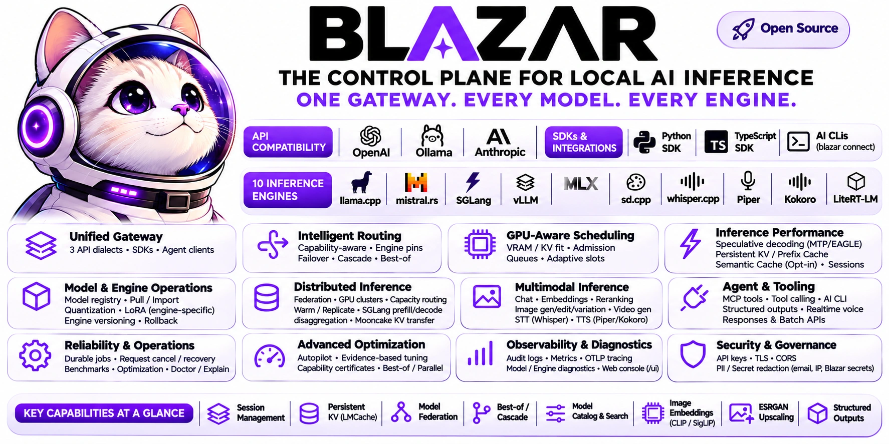

# Blazar

**The control plane for local AI inference.**

Unified OpenAI, Ollama and Anthropic gateway · Multi-engine serving · Resource-aware orchestration · Multimodal inference

[](https://github.com/santanu20/blazar/actions/workflows/ci.yml)
[](https://crates.io/crates/blazar)
[](https://github.com/santanu20/blazar/releases)
[](#license)
[](#installation)

<div align="center">




*Live CLI session: generation, engine inventory, speculation state and model-routing decisions from one daemon.*

**[Get started in 60 seconds](#60-second-quickstart)** · **[Why Blazar](#why-use-blazar)** · **[Features](#features)** · **[Benchmark evidence](#benchmark-snapshot)** · **[API reference](docs/4.API_SPEC.md)**

</div>

---

## What is Blazar?

Blazar is a **local AI gateway and runtime orchestrator** in one Rust binary. Applications connect to one endpoint; Blazar manages model storage, selects or pins inference engines, plans workloads against available hardware, and controls admission, concurrency, lifecycle and diagnostics.

**Bring your client. Bring your model. Blazar handles the serving stack.**

Blazar is the control plane around inference engines. The engines still perform inference: Blazar does not replace them, train models, or require a hosted service.

### Product capabilities at a glance

| Need | What Blazar provides |
|---|---|
| One endpoint for existing AI applications | Native OpenAI, Ollama and Anthropic API dialects, plus a Python SDK |
| Multiple model/runtime families | Capability-aware routing across 10 inference-engine lanes |
| Hardware-aware serving | VRAM/KV fit planning, admission control, adaptive slots and co-residency |
| Better throughput and latency | Speculative decoding (MTP/EAGLE/draft pairs), cache/session management and workload-aware scheduling |
| Model operations | Search, pull, import, inspect, pin, tune, snapshot, restore and engine version management |
| Reuse existing model files | Scan and reuse Ollama, Hugging Face Hub and LM Studio caches; verify bytes and hardlink instead of downloading again where possible |
| Several machines as one pool | Opt-in federation with capacity-aware warm, replicate and route operations |
| Other machines' GPUs | Opt-in cluster joining and remote RPC workers; remote capacity participates in spawn planning |
| Agent and tool workflows | Server-mediated MCP tool calling for OpenAI, Ollama and Anthropic clients |
| Multimodal workloads | Text, embeddings, reranking, image generation/editing/upscaling, video, speech-to-text, text-to-speech and realtime voice |
| Work that survives restarts | SQLite-backed durable jobs, cancellation, artifacts and restart-safe response chains |
| Operability | CLI diagnostics, explainable routing, read-only web console, metrics, OTLP and audit logs |
| Local security controls | Loopback-by-default serving, optional scoped API keys, TLS, explicit CORS and PII scrubbing |

---

## 60-second quickstart

### 1. Install

#### Linux / macOS

```sh
curl --proto '=https' --tlsv1.2 -fsSL \
  https://raw.githubusercontent.com/santanu20/blazar/v0.34.1/scripts/install.sh \
  | BLAZAR_REPO=santanu20/blazar sh
```

#### Windows PowerShell

```powershell
irm https://raw.githubusercontent.com/santanu20/blazar/v0.34.1/scripts/install.ps1 | iex
```

Also available: `cargo binstall blazar` for the prebuilt binary, `cargo install blazar` to compile it, or [build from source](#installation).

The Blazar binary and inference engines are separate artifacts. The installer can bootstrap the default engine; manage it explicitly with `blazar engine update`. Set `BLAZAR_INSTALL_ENGINE=0` to skip engine bootstrap.

### 2. Pull or reuse a model

```sh
blazar search qwen3 instruct
blazar pull qwen3-0.6b
blazar pull ggml-org/Qwen3-8B-GGUF:Q4_K_M
blazar import /path/to/model.gguf --name mymodel
blazar import --scan
```

`blazar import --scan` lists reusable models from Ollama, the Hugging Face Hub cache and LM Studio. When a matching local model is available, Blazar verifies size and SHA-256 bytes and can hardlink it into its model store instead of downloading another copy.

### 3. Serve and run

```sh
blazar serve
blazar run qwen3-0.6b
```

The gateway listens on `http://127.0.0.1:11435` by default.

```sh
curl http://127.0.0.1:11435/v1/chat/completions \
  -H 'Content-Type: application/json' \
  -d '{
    "model": "qwen3-0.6b",
    "messages": [{"role": "user", "content": "Explain local inference in one paragraph."}]
  }'
```

---

## Use your existing clients

No application rewrite is required: point clients at the compatible Blazar surfaces.

| Client / dialect | Base URL | Examples |
|---|---|---|
| OpenAI SDK | `http://127.0.0.1:11435/v1` | Chat/completions, Responses, embeddings, rerank, batches, files, audio, images and videos |
| Ollama clients | `OLLAMA_HOST=http://127.0.0.1:11435` | Chat, generate, tags, ps, pull, embeddings, rerank, tokenize and model inspection |
| Anthropic SDK | `http://127.0.0.1:11435` | Messages and Messages Batch API |
| SGLang-native clients | `http://127.0.0.1:11435` | Native `/generate` passthrough for SGLang-lane models |
| Blazar Python SDK | `BLAZAR_URL=http://127.0.0.1:11435` | Chat, streaming, best-of/MCP tools, process listing, explain, failover, realtime voice and Anthropic batches |

The Python SDK lives in [`sdk/python`](sdk/python). This README does not claim feature parity for an independently documented TypeScript SDK.

Blazar can run alongside an existing Ollama installation and can later serve on port `11434` as a port-level replacement.

### AI CLIs and agents

```sh
blazar launch <command>
blazar connect
blazar connect --write
blazar connect opencode --write --all-models
blazar connect pi --write
```

`blazar connect` prepares or applies integrations for Codex, Claude Code, Continue, Cline, Open WebUI, opencode and pi (oh-my-pi). Writes are backed up and rolled back if the test request fails. Other OpenAI-compatible, Ollama-compatible or Anthropic-compatible clients can connect directly to the gateway.

Every gateway-rendered error carries a stable machine-readable `blazar_code`; see [`docs/error-codes.md`](docs/error-codes.md) or `GET /api/errors`.

### MCP tool calling for any supported client

Any application using the OpenAI, Anthropic or Ollama dialects can use MCP tools through Blazar. Register local stdio commands or remote Streamable HTTP MCP servers once; Blazar advertises the tools, dispatches calls, passes arguments and replays results server-side.

```toml
[[mcp]]
name = "fetch"
command = ["uvx", "mcp-server-fetch"]

[[mcp]]
name = "remote"
url = "http://mcp.internal:8808/mcp"

mcp_default = "all"
```

A request can opt in with the `mcp` field or `x-blazar-mcp` header. Configuration owners declare servers; keyed clients can select only among configured servers. See [`docs/7.SETUP.md`](docs/7.SETUP.md).

---

## Why use Blazar?

Blazar is useful when local inference has outgrown one model, one runtime and one process.

| Approach | Best when | What Blazar adds |
|---|---|---|
| Direct engine server | One runtime and one model | Gateway compatibility, model operations, admission, routing, lifecycle and diagnostics |
| Ollama | Simple local model management | Multiple engine families, explicit routing, deeper resource planning and lifecycle controls |
| SGLang / vLLM-style runtime | High-throughput serving on one runtime | A higher-level control plane across heterogeneous runtimes |
| Custom scripts / many daemons | Bespoke infrastructure | One API, one configuration model and one operator workflow |

If one model, one runtime and one process meet the need, a direct engine server is simpler. Blazar is intentionally not necessary for that case.

---

## Engines and routing

Blazar's README lists these 10 engine lanes:

| Engine | Role | Typical workloads |
|---|---|---|
| **llama.cpp** | Mainstream local text serving | GGUF and quantized local models |
| **mistral.rs** | Alternative text runtime | Supported GGUF and safetensors models |
| **SGLang** | Safetensors-oriented serving | AWQ, GPTQ and FP8 safetensors models |
| **vLLM** | Throughput-first OpenAI-native serving | Hugging Face safetensors directories |
| **MLX** | Apple-Silicon and CUDA-backed serving | MLX quantized model directories |
| **stable-diffusion.cpp** | Media generation | Diffusion images and video |
| **whisper.cpp** | Speech recognition | Transcription and translation |
| **Piper** | Offline speech synthesis | Local TTS voices |
| **Kokoro** | Neural speech synthesis | Kokoro-82M ONNX voices |
| **LiteRT-LM** (`openaihost`) | Edge-optimized text serving | `.litertlm` bundles |

Full lane inventory and channel policy: [`docs/engines.md`](docs/engines.md).

Routing follows model format and engine capability. The default preserves single-active-engine behavior; per-model engine pins provide deterministic placement. Curated capability lanes cover GGUF architectures not yet supported by the mainstream llama.cpp lane.

For newly released GGUF architectures, Blazar can build a matching active curated registry lane. Automatic capability-lane installation is configurable and uses reviewed, immutable, signature-verified registry entries; arbitrary GitHub forks are not discovered or compiled automatically. See [automatic capability-lane installation](docs/9.USAGE.md).

---

## Features

### 1. Unified API gateway and request-path intelligence

Three native API dialects: OpenAI, Ollama and Anthropic. Request-path features include thinking-effort mapping, `<think>` leak suppression, structured-output receipts, forced-tool-choice handling, Anthropic cache accounting and Batch API, Responses API conversation chains and background jobs, plus engine passthrough utilities such as tokenize, detokenize, apply-template and infill.

Reference: [`docs/4.API_SPEC.md`](docs/4.API_SPEC.md).

### 2. Intelligent routing and advanced orchestration

Capability-aware routing, per-model engine pins, ordered failover chains, cascade routing (cheap-first escalation), per-request `best_of` fan-out, validated parallel choices (`n` 1–8), typed decision models and explainable routing decisions.

### 3. GPU / VRAM / KV-aware scheduling

`fit` previews VRAM, KV and slot requirements before a model is started or downloaded. Blazar provides bounded admission under saturation, priority handling, adaptive slot reshaping from live telemetry and co-residency planning.

### 4. Speculative decoding and performance controls

Speculative decoding supports MTP, EAGLE and draft-pair modes, with lane-aware draft selection, n-gram fallback and closed-loop governors that can park speculation when acceptance collapses. Performance work is measured through the live gateway and stored as experiment receipts.

### 5. Model registry, storage reuse and lifecycle

Search, pull, import, inspect, pin, snapshot, restore, quantize and tune models. `import --scan` finds reusable models in Ollama, Hugging Face Hub and LM Studio caches. Matching files are checked by size and SHA-256 before hardlink reuse. Engine installs are versioned side-by-side, verified, capability-probed and protected by regression gates and rollback.

### 6. Federation and opt-in GPU clusters

Federation is strictly opt-in: without `[[remotes]]`, requests stay on the local machine. Peers publish capacity; routing can prefer warm models, queue wait and free VRAM. `warm`, `replicate` and `route` manage placement. Opt-in cluster joining allows donor machines to contribute GPU capacity to spawn planning. Remote RPC workers are available for trusted networks; the RPC protocol itself has no authentication.

### 7. Sessions, persistent KV and cache

Session save/restore, automatic KV session banking on graceful stop, prefix-cache visibility, opt-in semantic cache and warm-on-pull. The README describes session banking and cache visibility; cache features remain dependent on the configured engine and supported path.

### 8. Multimodal inference and realtime voice

Text generation, embeddings, late-chunking opt-in, reranking, image generation and editing, ESRGAN upscaling, image embeddings through CLIP/SigLIP, video generation, streaming transcription with Silero VAD, word timestamps, Piper TTS and realtime WebSocket voice (Whisper STT → chat → Piper TTS).

### 9. MCP and agent infrastructure

Server-mediated MCP tool calling for OpenAI, Anthropic and Ollama clients. Blazar supports local stdio and remote Streamable HTTP servers, per-request selection or a configured default, tool dispatch and result replay.

### 10. Autopilot, benchmarking and evidence-based optimization

`plan` previews the run decision; `run` produces a readiness card; `scorecard` assembles stored benchmark and certificate evidence; `autopilot` recommends work and can apply supported actions. `optimize --plan` audits evidence and recommends tuning; `optimize --run` measures candidates through the live gateway; `optimize --apply` adopts only verified winners. Experiments are recorded in an append-only ledger. Capability certificates gate admission on verified failures.

### 11. Durable jobs and request reliability

A SQLite ledger persists durable jobs, events, cancellation state and artifacts. Crashes mark interrupted work as abandoned; request cards can be inspected and cancelled from another connection. Responses API `previous_response_id` chains are restart-safe.

### 12. Diagnostics, observability and read-only web console

CLI diagnostics include `doctor`, `why`, `watch`, `explain` and `model-doctor`. The gateway exposes capacity and fit read models, metrics, OTLP, audit JSONL and request-level engine-degradation warnings. `/ui` is a zero-dependency, read-only operations console with TTFT/TPOT, models, engines, compute census, benchmarks, jobs and sessions.

### 13. Local-first security and network controls

Loopback by default; optional scoped API keys, TLS, explicit CORS, DNS-rebinding hardening on loopback binds, a guard against keyless non-loopback serving unless explicitly enabled, audit logging, PII scrubbing and opt-in OTLP. These are configurable controls, not a claim that every deployment is automatically hardened.

---

## Benchmark snapshot

Two committed campaigns and their full receipts are documented in [`BENCHMARK.md`](BENCHMARK.md). The results below describe specific tested configurations, not universal guarantees.

| Workload | Blazar | Reference | Interpretation |
|---|---:|---:|---|
| Single-stream decode | **41.07 t/s** | 41.64 t/s direct engine | **~1.4%** gateway overhead |
| Single-stream TTFT p50 / ITL p99 | **120 ms / 25.8 ms** | 121 / 25.2 ms direct; 122 / **75.0 ms** Ollama | parity with direct; **~3x** lower tail than Ollama |
| Cached prefill | **7,494 t/s** | 7,359 t/s direct | parity-better |
| Long-context hold (2k -> 16k) | 41.1 -> 40.6 t/s | 6,145 MiB peak vs Ollama 6,829 | -1.2% across the ladder, leaner memory |
| Cold start (page cache dropped) | **4.8 s** | 4.6 s Ollama (warm daemon) | parity incl. full spawn |
| Idle wake | **2.4-3.5 s** | 6.2 s Ollama | **~2x** faster wake |
| Tool-call TTFT p50 | **117 ms** | 285 ms Ollama | **~2.4x** lower |
| Concurrent, matched slots, C=1 | **423.7 t/s** | 373.3 t/s direct engine | **1.14x** - parity-to-better (singleflight default-off) |
| Concurrent, matched slots, C=4 | **604.9 t/s** | 594.7 t/s direct engine | **1.02x** aggregate at load |
| Concurrent, matched slots, C=8 | **597.2 t/s** | 605.8 t/s direct engine | **0.99x** at saturation (was **0.72x** before the serialization fix) |
| Concurrent throughput, C=4 | **104.8 t/s** | 33.6 t/s Ollama lane | **~3.1x** system throughput |
| Concurrent TTFT p99, C=4 | **554 ms** | 15.9 s Ollama lane | Lower tail latency |
| Adaptive serving | **49 -> 63 t/s** | - | **~28%** gain, 0 failed requests |

Concurrency rows above the Ollama block are the current-release ladder (8 x 64-token bodies, temp 0, identical child argv both sides; methodology and the pre-fix ladder live in the committed audit report [`bench-artifacts/20261031-benchmark-audit/report.md`](bench-artifacts/20261031-benchmark-audit/report.md), the post-serialization-fix ladder - C1 1.135, C4 1.017, C8 0.986 - in [`docs/research/2026-10-31-recursive-self-improvement-research.md`](docs/research/2026-10-31-recursive-self-improvement-research.md) with fix commit `299bf5a`; raw receipts also persist in the daemon store via `blazar bench` history).

Where the gateway can matter - scheduling, residency, cache, tail control, tools - Blazar leads Ollama by receipt:

| Surface | Blazar | Ollama | Margin |
|---|---:|---:|---|
| ITL p99 (tail smoothness) | **25.8 ms** | 75.0 ms | **~3x** |
| Idle wake | **2.4-3.5 s** | 6.2 s | **~2x** |
| Tool-call TTFT p50 | **117 ms** | 285 ms | **~2.4x** |
| TTFT p99 under load, C=4 | **554 ms** | 15.9 s | **~28x** |
| Cached-path TTFT | **~0.4 s** | 6.1-6.5 s | **~15x** |
| Throughput under load, C=4 | **104.8 t/s** | 33.6 t/s | **~3.1x** |

The two parity rows in the table above are physics, not lost ground: single-stream TTFT is the same engine doing prefill in every lane (the relay adds ~0 ms), and cold start is disk-bandwidth-bound model loading - where Ollama's 4.6 s reference even ran on a warm daemon while Blazar's 4.8 s included the full gateway boot.

The matched-concurrency rows pin the gateway child to the direct lane's own slot count, isolating orchestration cost from slot-capacity differences; the default lane (slots=4, unified 64k KV) legitimately trades decode speed for context capacity on an 8 GiB card. Campaigns measure more than tokens/s: prefill, saturation, cache reuse, tool-call and structured-output quality, cold starts, scheduling, lifecycle, and media lanes - per-campaign environments and dates are recorded with each receipt in BENCHMARK.md. Reproduce with `blazar bench <model>` or `python3 scripts/bench_matrix.py --blazar-bin target/release/blazar --md BENCHMARK.md`.

---

## Configuration

Configuration lives at `~/.config/blazar/config.toml`; prefer the CLI for routine changes.

```sh
blazar config defaults
blazar config list
blazar config get <key>
blazar config set <key> <value>
blazar config unset <key>
```

| Area | Examples |
|---|---|
| Serving | `host`, `port`, `default_ctx`, `slots`, `max_loaded_models` |
| Memory / quality | `cache_type`, `kv_unified`, `ctx_extend` |
| Scheduling | `singleflight`, `adaptive_slots`, admission, priorities |
| Speculation | `spec`, draft selection, n-gram lookup |
| Routing | `engine_routing`, per-model overrides, replicas |
| Access | keys, TLS, CORS, remotes |
| Observability | `audit_log`, `pii_scrub`, `otlp_endpoint` |
| Media | diffusion tuning, RPC, audio-lane timeouts |

`blazar config defaults` is the authoritative live reference. Authentication is optional for a default local deployment.

---

## Common commands

| Task | Command |
|---|---|
| Start gateway | `blazar serve` |
| Run a model | `blazar run <model>` |
| Run with a workload posture | `blazar run <model> --intent agent` |
| Preview a model | `blazar plan <model>` |
| Performance and quality card | `blazar scorecard <model>` |
| Evidence-gap advice | `blazar optimize <model> --plan` |
| Measured optimization | `blazar optimize <model> --run` |
| Adopt a verified candidate | `blazar optimize <model> --apply <experiment-id>` |
| Apply a config posture | `blazar config preset balanced` |
| Autopilot recommendations | `blazar autopilot` / `blazar autopilot --apply` |
| Pull / import models | `blazar pull <target>` / `blazar import <file> --name <name>` |
| Reuse existing model stores | `blazar import --scan` |
| Inspect models | `blazar list`, `blazar show <model>`, `blazar ps` |
| Quantize | `blazar quantize <model> <out-quant>` |
| Benchmark | `blazar bench <model>` |
| Connect AI clients | `blazar connect --write` |
| Explain serving configuration | `blazar explain <model>` |
| Certify model capabilities | `blazar model-doctor <model>` / `blazar certify <model>` |
| Speculative-decode candidates | `blazar drafts <model>` |
| Distributed inference worker | `blazar rpc` |
| Health / diagnostics | `blazar doctor`, `blazar doctor --fix`, `blazar why`, `blazar watch` |
| Preview fit / co-residency | `blazar fit <target>`, `blazar coreside` |
| Manage engines | `blazar engine update / list / use / rollback / install / build / prune / delta` |
| Federation | `blazar warm`, `blazar replicate`, `blazar route` |
| Sessions / LoRA | `blazar session save/restore`, `blazar lora add/rm/list` |
| Audio | `blazar whisper <file>`, `blazar tts "<text>"` |
| Disk | `blazar storage`, `blazar prune --orphans/--unused` |
| Keys / snapshots | `blazar keys ...`, `blazar snapshot` |
| Search / self-update | `blazar search ...`, `blazar upgrade` |

Full CLI surface: `blazar --help`. Complete route contract: [`docs/4.API_SPEC.md`](docs/4.API_SPEC.md).

---

## Installation

### Release binaries

- Linux: x86_64, aarch64, armv7
- macOS: Intel and Apple Silicon
- Windows: x64 and ARM64

### crates.io

```sh
cargo install blazar
```

With [cargo-binstall](https://github.com/cargo-bins/cargo-binstall):

```sh
cargo binstall blazar
```

### Build from source

```sh
cargo install --path crates/blazar-cli
# or, from a checkout:
sh scripts/install.sh --build
```

Windows:

```powershell
irm https://raw.githubusercontent.com/santanu20/blazar/main/scripts/install.ps1 -OutFile install.ps1
.\install.ps1 -Build
```

Package-manager integrations: [Homebrew](packaging/homebrew), [Scoop](packaging/scoop), [Winget](packaging/winget) and the [AUR PKGBUILD](packaging/PKGBUILD).

---

## Architecture

Blazar is a Rust workspace with explicit boundaries; unsafe code is denied by default. CI runs formatting, Clippy, tests and installer checks.

```text
crates/
├── blazar-core       config, model catalog, GGUF metadata, profiles,
│                     hardware, storage and domain logic
├── blazar-runtime    downloads, engines, supervisor, lifecycle,
│                     benchmarking, quantization and upgrades
├── blazar-gateway    HTTP APIs, translation, scheduling, sessions,
│                     cache, media and observability
└── blazar-cli        the `blazar` executable and interactive CLI
```

---

## Documentation

This README is the product entry point; implementation and operational detail live in dedicated documents. The documentation series is also hosted at [santanu20.github.io/blazar](https://santanu20.github.io/blazar/).

| Document | Purpose |
|---|---|
| [`docs/1.SYSTEM_OVERVIEW.md`](docs/1.SYSTEM_OVERVIEW.md) | Product shape and system overview |
| [`docs/2.ARCHITECTURE.md`](docs/2.ARCHITECTURE.md) | Internal architecture and lifecycle |
| [`docs/3.DATA_MODEL.md`](docs/3.DATA_MODEL.md) | SQLite schema and invariants |
| [`docs/4.API_SPEC.md`](docs/4.API_SPEC.md) | HTTP API and CLI reference |
| [`docs/6.BUSINESS_RULES.md`](docs/6.BUSINESS_RULES.md) | Routing, admission, validation and eviction rules |
| [`docs/7.SETUP.md`](docs/7.SETUP.md) | Installation, deployment and configuration |
| [`docs/8.DO_NOT_BREAK.md`](docs/8.DO_NOT_BREAK.md) | Maintainer invariants and compatibility rules |
| [`docs/9.USAGE.md`](docs/9.USAGE.md) | End-user workflows and troubleshooting |
| [`docs/10.SCIENTIFIC.md`](docs/10.SCIENTIFIC.md) | VRAM/KV math, GGUF parsing and numerical methods |
| [`BENCHMARK.md`](BENCHMARK.md) | Benchmark methodology and results |
| [`CHANGELOG.md`](CHANGELOG.md) | Release history |

---

## Contributing

1. Read [`docs/8.DO_NOT_BREAK.md`](docs/8.DO_NOT_BREAK.md).
2. For architectural changes, read [`docs/2.ARCHITECTURE.md`](docs/2.ARCHITECTURE.md) and [`docs/6.BUSINESS_RULES.md`](docs/6.BUSINESS_RULES.md).
3. Run formatting, Clippy, tests and installer checks. The CI workflow is the source of truth.

---

## Credits

Blazar is an orchestration layer built on upstream open-source projects:

- Inference runtimes: [llama.cpp](https://github.com/ggml-org/llama.cpp), [mistral.rs](https://github.com/EricLBuehler/mistral.rs), [SGLang](https://github.com/sgl-project/sglang), [vLLM](https://github.com/vllm-project/vllm), [MLX](https://github.com/ml-explore/mlx), [stable-diffusion.cpp](https://github.com/leejet/stable-diffusion.cpp), [whisper.cpp](https://github.com/ggml-org/whisper.cpp), [Piper](https://github.com/rhasspy/piper), [Kokoro](https://github.com/hexgrad/kokoro) and [LiteRT-LM](https://github.com/google-ai-edge/LiteRT-LM).
- Models and architectures: [Silero VAD](https://github.com/snakers4/silero-vad) for speech detection in streaming audio; [ModernBERT](https://github.com/AnswerDotAI/modernbert) for the System One decision-model family.

Those projects provide inference runtimes and supporting components. Model weights remain subject to their publishers' licenses and distribution terms.

---

## License

Dual-licensed under [MIT](LICENSE-MIT) or [Apache-2.0](LICENSE-APACHE).
