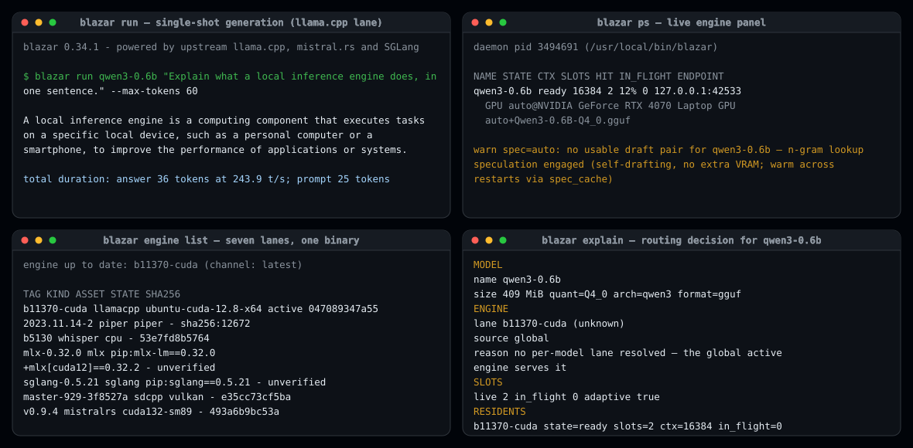

# Blazar

**The control plane for local AI inference.**

Unified OpenAI, Ollama and Anthropic gateway · Multi-engine serving · Resource-aware orchestration · Multimodal inference

[](https://github.com/santanu20/blazar/actions/workflows/ci.yml)
[](https://crates.io/crates/blazar)
[](https://github.com/santanu20/blazar/releases)
[](#license)
[](#installation)

<div align="center">




*Live CLI session: generation, engine inventory, speculation state and model-routing decisions from one daemon.*

**[Get started in 60 seconds](#60-second-quickstart)** · **[Why Blazar](#why-use-blazar)** · **[Features](#features)** · **[Benchmark evidence](#benchmark-snapshot)** · **[API reference](https://github.com/santanu20/blazar/blob/main/docs/4.API_SPEC.md)**

</div>

---

## What is Blazar?

Blazar is a **local-first control plane for model serving**, distributed as one Rust binary. Applications connect to one endpoint; Blazar manages model storage, chooses or pins inference engines, plans workloads against available hardware, and coordinates admission, concurrency, routing, lifecycle and diagnostics.

The inference engines still execute the model. Blazar coordinates the serving stack around them; it does not train models or require a hosted control plane.

### Product capabilities at a glance

| Need | What Blazar provides |
|---|---|
| One endpoint for existing AI applications | Native OpenAI, Ollama and Anthropic API dialects, plus a Python SDK |
| Multiple model/runtime families | Capability-aware routing across 10 inference-engine lanes |
| Hardware-aware serving | VRAM/KV fit planning, admission control, adaptive slots and co-residency |
| Better throughput and latency | Speculative decoding, cache/session management, workload-aware scheduling and measured optimization |
| Model operations | Search, pull, import, inspect, pin, tune, snapshot, restore, KV inventory/import and engine version management |
| Reuse existing model files | Scan and reuse Ollama, Hugging Face Hub and LM Studio caches; verify bytes and hardlink instead of downloading again where possible |
| Several machines as one pool | Remote federation, dynamically joined RPC workers, and logical model pools with ordered, least-wait, warm-first or adaptive replica selection |
| Other machines' GPUs | Opt-in cluster joining and remote RPC workers; remote capacity participates in spawn planning |
| Agent and tool workflows | Server-mediated MCP tool calling for OpenAI, Ollama and Anthropic clients |
| Multimodal workloads | Text, embeddings, reranking, image generation/editing/upscaling, video, speech-to-text, text-to-speech and realtime voice |
| Work that survives restarts | SQLite-backed durable jobs, cancellation, artifacts and restart-safe response chains |
| Operability | CLI diagnostics, derived engine capability cards, explainable routing, read-only web console, metrics, OTLP and audit logs |
| Local security controls | Loopback-by-default serving, optional scoped API keys, TLS, explicit CORS, audit controls and PII scrubbing |

---

## 60-second quickstart

### 1. Install

#### Linux / macOS

```sh
curl --proto '=https' --tlsv1.2 -fsSL \
  https://raw.githubusercontent.com/santanu20/blazar/v0.34.2/scripts/install.sh \
  | BLAZAR_REPO=santanu20/blazar sh
```

#### Windows PowerShell

```powershell
irm https://raw.githubusercontent.com/santanu20/blazar/v0.34.2/scripts/install.ps1 | iex
```

Also available: `cargo binstall blazar` for the prebuilt binary, `cargo install blazar` to compile it, or [build from source](#installation).

The Blazar binary and inference engines are separate artifacts. The Linux/macOS shell installer bootstraps the default llama.cpp engine; the Windows installer installs the CLI, so run `blazar engine update` there before serving a model. Set `BLAZAR_INSTALL_ENGINE=0` to skip the Linux/macOS engine bootstrap. Set `BLAZAR_VERSION` to pin an installer run to a release.

### 2. Pull or reuse a model

```sh
blazar search qwen3 instruct
blazar pull qwen3-0.6b
blazar pull ggml-org/Qwen3-8B-GGUF:Q4_K_M
blazar import /path/to/model.gguf --name mymodel
blazar import --scan
```

`blazar import --scan` lists reusable models from Ollama, the Hugging Face Hub cache and LM Studio. When a matching local model is available, Blazar verifies size and SHA-256 bytes and can hardlink it into its model store instead of downloading another copy.

### 3. Serve and run

```sh
blazar serve
blazar run qwen3-0.6b
```

The gateway listens on `http://127.0.0.1:11435` by default.

```sh
curl http://127.0.0.1:11435/v1/chat/completions \
  -H 'Content-Type: application/json' \
  -d '{
    "model": "qwen3-0.6b",
    "messages": [{"role": "user", "content": "Explain local inference in one paragraph."}]
  }'
```

---

## Use your existing clients

No application rewrite is required: point clients at the compatible Blazar surfaces.

| Client / dialect | Base URL | Examples |
|---|---|---|
| OpenAI SDK | `http://127.0.0.1:11435/v1` | Chat/completions, Responses, embeddings, rerank, batches, files, audio, images and videos |
| Ollama clients | `OLLAMA_HOST=http://127.0.0.1:11435` | Chat, generate, tags, ps, pull, embeddings, rerank, tokenize and model inspection |
| Anthropic SDK | `http://127.0.0.1:11435` | Messages and Messages Batch API |
| SGLang-native clients | `http://127.0.0.1:11435` | Native `/generate` passthrough for SGLang-lane models |
| Blazar Python SDK | `BLAZAR_URL=http://127.0.0.1:11435` | Chat, streaming, best-of/MCP tools, process listing, explain, failover, realtime voice and Anthropic batches |

The first-party Python SDK lives in [`sdk/python`](https://github.com/santanu20/blazar/tree/main/sdk/python); an independently packaged, zero-dependency TypeScript client lives in [`sdk/ts`](https://github.com/santanu20/blazar/tree/main/sdk/ts). They are separate clients with different coverage: the Python SDK includes realtime voice and Anthropic batch workflows, while the TypeScript SDK currently focuses on chat/streaming and core operations. See each SDK README for its exact surface.

Blazar can run alongside an existing Ollama installation and can later serve on port `11434` as a port-level replacement.

### AI CLIs and agents

```sh
blazar launch <command>
blazar connect
blazar connect --write
blazar connect opencode --write --all-models
blazar connect pi --write
```

`blazar connect` prepares or applies integrations for Codex, Claude Code, Continue, Cline, Open WebUI, opencode and pi (oh-my-pi). Writes are backed up and rolled back if the test request fails. Other OpenAI-compatible, Ollama-compatible or Anthropic-compatible clients can connect directly to the gateway.

Blazar-rendered errors on OpenAI-shaped gateway surfaces include a stable machine-readable `blazar_code`; engine errors forwarded verbatim and the Ollama-native error shape are exceptions. See [`docs/error-codes.md`](https://github.com/santanu20/blazar/blob/main/docs/error-codes.md) or `GET /api/errors`.

### MCP tool calling for any supported client

Any application using the OpenAI, Anthropic or Ollama dialects can use MCP tools through Blazar. Register local stdio commands or remote Streamable HTTP MCP servers once; Blazar advertises the tools, dispatches calls, passes arguments and replays results server-side.

```toml
[[mcp]]
name = "fetch"
command = ["uvx", "mcp-server-fetch"]

[[mcp]]
name = "remote"
url = "http://mcp.internal:8808/mcp"

mcp_default = "all"
```

A request can opt in with the `mcp` field or `x-blazar-mcp` header. Configuration owners declare servers; keyed clients can select only among configured servers. See [`docs/7.SETUP.md`](https://github.com/santanu20/blazar/blob/main/docs/7.SETUP.md).

---

## Why use Blazar?

Blazar is useful when local inference has outgrown one model, one runtime and one process.

| Approach | Best when | What Blazar adds |
|---|---|---|
| Direct engine server | One runtime and one model | Gateway compatibility, model operations, admission, routing, lifecycle and diagnostics |
| Ollama | Simple local model management | Multiple engine families, explicit routing, deeper resource planning and lifecycle controls |
| SGLang / vLLM-style runtime | High-throughput serving on one runtime | A higher-level control plane across heterogeneous runtimes |
| Custom scripts / many daemons | Bespoke infrastructure | One API, one configuration model and one operator workflow |

If one model, one runtime and one process meet the need, a direct engine server is simpler. Blazar is intentionally not necessary for that case.

---

## Engines and routing

Blazar's README lists these 10 engine lanes:

| Engine | Role | Typical workloads |
|---|---|---|
| **llama.cpp** | Mainstream local text serving | GGUF and quantized local models |
| **mistral.rs** | Alternative text runtime | Supported GGUF and safetensors models |
| **SGLang** | Safetensors-oriented serving | AWQ, GPTQ and FP8 safetensors models |
| **vLLM** | Throughput-first OpenAI-native serving | Hugging Face safetensors directories |
| **MLX** | Apple-Silicon and CUDA-backed serving | MLX quantized model directories |
| **stable-diffusion.cpp** | Media generation | Diffusion images and video |
| **whisper.cpp** | Speech recognition | Transcription and translation |
| **Piper** | Offline speech synthesis | Local TTS voices |
| **Kokoro** | Neural speech synthesis | Kokoro-82M ONNX voices |
| **LiteRT-LM** (`openaihost`) | Edge-optimized text serving | `.litertlm` bundles |

Full lane inventory and channel policy: [`docs/engines.md`](https://github.com/santanu20/blazar/blob/main/docs/engines.md).

Routing follows model format and engine capability. The default preserves single-active-engine behavior; per-model engine pins provide deterministic placement. Curated capability lanes cover GGUF architectures not yet supported by the mainstream llama.cpp lane.

For newly released GGUF architectures, Blazar can build a matching active curated registry lane. Automatic capability-lane installation is configurable and uses reviewed, immutable, signature-verified registry entries; arbitrary GitHub forks are not discovered or compiled automatically. See [automatic capability-lane installation](https://github.com/santanu20/blazar/blob/main/docs/9.USAGE.md).

---

## Features

### 1. Unified API gateway and request-path intelligence

Three native API dialects: OpenAI, Ollama and Anthropic. Request-path features include thinking-effort mapping, `<think>` leak suppression, structured-output receipts, forced-tool-choice handling, Anthropic cache accounting and Batch API, Responses API conversation chains and background jobs, plus engine passthrough utilities such as tokenize, detokenize, apply-template and infill.

Reference: [`docs/4.API_SPEC.md`](https://github.com/santanu20/blazar/blob/main/docs/4.API_SPEC.md).

### 2. Intelligent routing and advanced orchestration

Capability-aware routing, per-model engine pins, ordered failover chains, cascade routing (cheap-first escalation), per-request `best_of` fan-out, validated parallel choices (`n` 1–8), typed decision models and explainable routing decisions.

### 3. GPU / VRAM / KV-aware scheduling

`fit` previews VRAM, KV and slot requirements before a model is started or downloaded. Blazar provides bounded admission under saturation, priority handling, adaptive slot reshaping from live telemetry and co-residency planning.

### 4. Speculative decoding and performance controls

Speculative decoding supports MTP, EAGLE and draft-pair modes, with lane-aware draft selection, n-gram fallback and closed-loop governors that can park speculation when acceptance collapses. Performance work is measured through the live gateway and stored as experiment receipts.

### 5. Model registry, storage reuse and lifecycle

Search, pull, import, inspect, pin, snapshot, restore, quantize and tune models. `import --scan` finds reusable models in Ollama, Hugging Face Hub and LM Studio caches. Matching files are checked by size and SHA-256 before hardlink reuse. Engine installs are versioned side-by-side, verified, capability-probed and protected by regression gates and rollback.

### 6. Federation, GPU fleets and logical model pools

Remote federation is opt-in through `[[remotes]]`; without remotes, traffic stays local. Blazar can warm and replicate models to remote gateways, explain cross-node placement, and use model pools (`[[model_pools]]`) to expose one logical model name over local and remote replicas. Pool strategies include `ordered`, `least_wait`, `warm_first` and `adaptive`, with cache-affinity signals and operator controls to drain, undrain, pin or unpin members.

GPU workers can join a gateway dynamically instead of being listed only in static `rpc_servers`. Joining supports a shared `fleet_token`, one-use expiring invites and per-worker session credentials; optional LAN discovery is off by default. These membership controls protect the fleet control plane, not the underlying RPC data protocol: llama.cpp RPC worker traffic itself has no authentication and must stay on a trusted network or protected tunnel. See [fleet setup](https://github.com/santanu20/blazar/blob/main/docs/7.SETUP.md) and the model-pool section there.

### 7. Sessions, persistent KV and cache

Session save/restore and automatic session banking preserve eligible llama.cpp slot KV across graceful unloads and restarts. `blazar kv status` and `blazar kv inspect <model>` report bank identity, size and state; `blazar kv gc --dry-run` identifies orphaned KV data, and `--apply` moves candidates to a timestamped backup directory rather than hard-deleting them.

Persistent vLLM KV offload is configured separately under `[vllm.kv_offload]` and managed by vLLM's OffloadingConnector; Blazar observes reuse (for example, through `cached_tokens`) rather than moving individual blocks through a gateway API. Cross-engine interchange is a separate, opt-in capability under `[kv.translation]` and requires an explicit `blazar kv import`. It is not universal or automatic. A live-certified example imports a 1,536-token prefix from the vLLM filesystem tier into a llama.cpp session bank; SGLang↔vLLM and MLX↔vLLM require different hardware/host conditions and are not claimed as universally live-certified. See [`docs/7.SETUP.md`](https://github.com/santanu20/blazar/blob/main/docs/7.SETUP.md) and the [KV certification receipt](https://github.com/santanu20/blazar/blob/main/bench-artifacts/2026-11-21-kv-codec-live-certs/README.md).

### 8. Multimodal inference and realtime voice

Text generation, embeddings, late-chunking opt-in, reranking, image generation and editing, ESRGAN upscaling, image embeddings through CLIP/SigLIP, video generation, streaming transcription with Silero VAD, word timestamps, Piper TTS and realtime WebSocket voice (Whisper STT → chat → Piper TTS).

### 9. MCP and agent infrastructure

Server-mediated MCP tool calling for OpenAI, Anthropic and Ollama clients. Blazar supports local stdio and remote Streamable HTTP servers, per-request selection or a configured default, tool dispatch and result replay.

### 10. Autopilot, benchmarking and evidence-based optimization

`plan` previews the run decision; `run` produces a readiness card; `scorecard` assembles stored benchmark and certificate evidence; `autopilot` recommends work and can apply supported actions. `optimize --plan` audits evidence and recommends tuning; `optimize --run` measures candidates through the live gateway; `optimize --apply` adopts only verified winners. Experiments are recorded in an append-only ledger. Capability certificates gate admission on verified failures.

### 11. Durable jobs and request reliability

A SQLite ledger persists durable jobs, events, cancellation state and artifacts. Crashes mark interrupted work as abandoned; request cards can be inspected and cancelled from another connection. Responses API `previous_response_id` chains are restart-safe.

### 12. Diagnostics, observability and read-only web console

CLI diagnostics include `doctor`, `why`, `watch`, `explain` and `model-doctor`. The gateway exposes capacity and fit read models, request-stage timing, metrics, OTLP, audit JSONL and request-level engine-degradation warnings. `blazar engine card` and `GET /api/engines` expose derived capability cards backed by lane predicates and install-time probes; `GET /api/fit` adds confidence, current media pressure and supported parallelism advice. `/ui` is a zero-dependency, read-only operations console with dashboard, models, engines, compute, benchmarks, jobs and sessions.

### 13. Local-first security and network controls

Loopback is the default serving posture. Optional controls include scoped API keys, TLS, explicit CORS, DNS-rebinding hardening on loopback binds, a guard against keyless non-loopback serving unless explicitly enabled, audit logging and PII scrubbing. Fleet membership can be protected by a shared token or one-use invites, but this does not authenticate the underlying RPC worker protocol. Remote HTTP credentials are subject to URL-scheme validation; use HTTPS for remote public endpoints. These are configurable controls, not a claim that every deployment is automatically hardened.

---

## Benchmark snapshot

Benchmark figures are workload-, engine-, model- and hardware-specific. The receipts below are from November 21, 2026; they are evidence for the tested configurations, not universal performance guarantees.

### Gateway overhead under matched concurrency

A November 21 saturation campaign compared Blazar with the same llama.cpp child binary, model and serving arguments on an RTX 4070 Laptop GPU (8 GiB), using Qwen2.5-0.5B, two rounds at each concurrency rung, and 128 generated tokens per stream. Aggregate gateway/direct throughput ratios were:

| Concurrent streams | Gateway / direct throughput | Interpretation |
|---:|---:|---|
| 1 | 1.204x | Gateway ran second; warmer page cache can flatter this result |
| 2 | 0.970x | 3.0% below direct |
| 4 | 1.051x | 5.1% above direct |
| 8 | 0.999x | At parity |
| 16 | 0.943x | 5.7% below direct at saturation |

Every rung completed with zero failed requests. The campaign used only two rounds on one machine, so treat these ratios as a measured diagnostic rather than a general speed claim. Its stage timings also record a cold-spawn admission outlier at low concurrency; at higher concurrency, dispatch and engine-slot queueing dominate the tail. See the [full saturation report and caveats](https://github.com/santanu20/blazar/blob/main/bench-artifacts/2026-11-21-gateway-saturation/README.md).

### Current vLLM and SGLang lane evidence

A separate November 21 campaign exercised vLLM 0.34.0 and SGLang 0.5.23 with a 953 MiB Qwen2.5-Coder-0.5B safetensors model on the same 8 GiB RTX 4070 Laptop host. Default-profile single-stream results were approximately 190 tokens/s for vLLM and 202 tokens/s for SGLang; measured TTFT was about 19 ms and 18 ms, respectively. The Ollama reference in that report uses a different GGUF runtime/model path and is not a like-for-like comparison. The campaign has documented error and environment cells and does not certify every configuration. See the [lane report](https://github.com/santanu20/blazar/blob/main/bench-artifacts/2026-11-21-vllm-sglang-lanes/README.md) and [vLLM tool-call fix receipt](https://github.com/santanu20/blazar/blob/main/bench-artifacts/2026-11-21-vllm-tools-fix/README.md).

### KV interchange proof

A live certification imported 24 complete 64-token blocks (1,536 tokens) from vLLM's persistent filesystem tier into a llama.cpp session bank for a matching F16 GGUF/HF model pair; the next llama.cpp spawn restored the prefix into slot KV. This proves that specific conversion path, not generic or automatic KV portability across all engines. See the [live certification](https://github.com/santanu20/blazar/blob/main/bench-artifacts/2026-11-21-kv-codec-live-certs/README.md).

The benchmark archive is indexed in [`bench-artifacts/INDEX.md`](https://github.com/santanu20/blazar/blob/main/bench-artifacts/INDEX.md). [`BENCHMARK.md`](https://github.com/santanu20/blazar/blob/main/BENCHMARK.md) is machine-rendered; its header identifies the **last render**, not necessarily the newest campaign. Check the campaign index and individual receipts before quoting a result.

## Configuration

Blazar reads `config.toml` from its platform config directory. On Linux the default is `~/.config/blazar/config.toml`; macOS and Windows use their native per-user config locations. An explicitly set `XDG_CONFIG_HOME` overrides the config root on every platform. The data directory follows the same platform/XDG rules (`~/.local/share/blazar` on Linux). On Unix, Blazar sets the config directory to owner-only permissions because it can contain API-key secrets.

Prefer the CLI for routine changes:

```sh
blazar config defaults
blazar config list
blazar config get <key>
blazar config set <key> <value>
blazar config unset <key>
```

| Area | Examples |
|---|---|
| Serving | `host`, `port`, `default_ctx`, `slots`, `max_loaded_models` |
| Memory / quality | `cache_type`, `kv_unified`, `ctx_extend`, `cache_ram_mb` |
| Scheduling | `singleflight`, `adaptive_slots`, admission, priorities |
| Speculation | `spec`, draft selection, n-gram lookup |
| Routing / pools | `engine_routing`, per-model overrides, replicas, `[[model_pools]]` |
| KV | `session_bank`, `[vllm.kv_offload]`, opt-in `[kv.translation]` |
| Fleet / network | `rpc_servers`, `fleet_token`, `fleet_open`, `discovery_enabled`, `[[remotes]]` |
| Access | API keys, TLS, CORS, per-key MCP access |
| Observability | `audit_log`, `pii_scrub`, `otlp_endpoint` |
| Media | diffusion tuning, RPC, audio-lane timeouts |

`blazar config defaults` and [`docs/7.SETUP.md`](https://github.com/santanu20/blazar/blob/main/docs/7.SETUP.md) are the authoritative live configuration references. Authentication remains optional for a default local deployment.

## Common commands

| Task | Command |
|---|---|
| Start gateway | `blazar serve` |
| Run a model | `blazar run <model>` |
| Run with a workload posture | `blazar run <model> --intent agent` |
| Preview a model | `blazar plan <model>` |
| Performance and quality card | `blazar scorecard <model>` |
| Evidence-gap advice | `blazar optimize <model> --plan` |
| Measured optimization | `blazar optimize <model> --run` |
| Adopt a verified candidate | `blazar optimize <model> --apply <experiment-id>` |
| Apply a config posture | `blazar config preset balanced` |
| Autopilot recommendations | `blazar autopilot` / `blazar autopilot --apply` |
| Pull / import models | `blazar pull <target>` / `blazar import <file> --name <name>` |
| Reuse existing model stores | `blazar import --scan` |
| Inspect models | `blazar list`, `blazar show <model>`, `blazar ps` |
| Quantize | `blazar quantize <model> <out-quant>` |
| Benchmark | `blazar bench <model>` |
| Connect AI clients | `blazar connect --write` |
| Explain serving configuration | `blazar explain <model>` |
| Certify model capabilities | `blazar model-doctor <model>` / `blazar certify <model>` |
| Speculative-decode candidates | `blazar drafts <model>` |
| Distributed inference worker | `blazar rpc` |
| Health / diagnostics | `blazar doctor`, `blazar doctor --fix`, `blazar why`, `blazar watch` |
| Preview fit / co-residency | `blazar fit <target>`, `blazar coreside` |
| Manage engines and inspect capabilities | `blazar engine update / list / use / rollback / install / build / prune / delta`; `blazar engine card [tag|--kind]` |
| Federation and fleets | `blazar warm`, `blazar replicate`, `blazar route`, `blazar rpc status`, `blazar init`, `blazar join`, `blazar agent run`, `blazar adopt` |
| Sessions / KV / LoRA | `blazar session save/restore`, `blazar kv status/inspect/gc/import`, `blazar lora add/rm/list` |
| Pools / operations | `blazar pool status/watch/drain/undrain/pin/unpin` |
| Audio | `blazar whisper <file>`, `blazar tts "<text>"` |
| Disk | `blazar storage`, `blazar prune --orphans/--unused` |
| Keys / snapshots / registry | `blazar keys ...`, `blazar snapshot`, `blazar registry keygen/sign/verify` |
| Search / self-update | `blazar search ...`, `blazar upgrade` |

Full CLI surface: `blazar --help`. Complete route contract: [`docs/4.API_SPEC.md`](https://github.com/santanu20/blazar/blob/main/docs/4.API_SPEC.md).

---

## Installation

### Release binaries

- Linux: x86_64, aarch64, armv7
- macOS: Intel and Apple Silicon
- Windows: x64 and ARM64

### crates.io

```sh
cargo install blazar
```

With [cargo-binstall](https://github.com/cargo-bins/cargo-binstall):

```sh
cargo binstall blazar
```

### Build from source

```sh
cargo install --path crates/blazar-cli
# or, from a checkout:
sh scripts/install.sh --build
```

Windows:

```powershell
irm https://raw.githubusercontent.com/santanu20/blazar/main/scripts/install.ps1 -OutFile install.ps1
.\install.ps1 -Build
```

Package-manager integrations: [Homebrew](https://github.com/santanu20/blazar/tree/main/packaging/homebrew), [Scoop](https://github.com/santanu20/blazar/tree/main/packaging/scoop), [Winget](https://github.com/santanu20/blazar/tree/main/packaging/winget) and the [AUR PKGBUILD](https://github.com/santanu20/blazar/blob/main/packaging/PKGBUILD). The workspace requires **Rust 1.95 or newer** (edition 2024) when building from source. The Linux/macOS shell installer installs the default llama.cpp engine unless `BLAZAR_INSTALL_ENGINE=0`; the Windows installer installs the CLI only, so run `blazar engine update` before serving a model.

---

## Architecture

Blazar is a four-crate Rust workspace with explicit boundaries; the workspace denies unsafe code by default. CI runs formatting, Clippy with warnings denied, workspace tests via nextest, an MSRV check, Linux/Windows/macOS test jobs, and installer/script checks.

```text
crates/
├── blazar-core       config, model catalog, GGUF metadata, profiles,
│                     hardware, storage and domain logic
├── blazar-runtime    downloads, engines, supervisor, lifecycle,
│                     benchmarking, quantization and upgrades
├── blazar-gateway    HTTP APIs, translation, scheduling, sessions,
│                     cache, media and observability
└── blazar-cli        the `blazar` executable and interactive CLI
```

---

## Documentation

This README is the product entry point; implementation and operational detail live in dedicated documents. The documentation series is also hosted at [santanu20.github.io/blazar](https://santanu20.github.io/blazar/).

| Document | Purpose |
|---|---|
| [`docs/1.SYSTEM_OVERVIEW.md`](https://github.com/santanu20/blazar/blob/main/docs/1.SYSTEM_OVERVIEW.md) | Product shape and system overview |
| [`docs/2.ARCHITECTURE.md`](https://github.com/santanu20/blazar/blob/main/docs/2.ARCHITECTURE.md) | Internal architecture and lifecycle |
| [`docs/3.DATA_MODEL.md`](https://github.com/santanu20/blazar/blob/main/docs/3.DATA_MODEL.md) | SQLite schema and invariants |
| [`docs/4.API_SPEC.md`](https://github.com/santanu20/blazar/blob/main/docs/4.API_SPEC.md) | HTTP API and CLI reference |
| [`docs/engines.md`](https://github.com/santanu20/blazar/blob/main/docs/engines.md) | Ten engine lanes, format routing, engine lifecycle and capability cards |
| [`docs/engine-coverage.md`](https://github.com/santanu20/blazar/blob/main/docs/engine-coverage.md) | Machine-checked engine capability and inventory coverage |
| [`docs/error-codes.md`](https://github.com/santanu20/blazar/blob/main/docs/error-codes.md) | Stable gateway error classifications and remediation |
| [`docs/benchmarks.md`](https://github.com/santanu20/blazar/blob/main/docs/benchmarks.md) | Benchmark methodology and selected campaign results |
| [`docs/6.BUSINESS_RULES.md`](https://github.com/santanu20/blazar/blob/main/docs/6.BUSINESS_RULES.md) | Routing, admission, validation and eviction rules |
| [`docs/7.SETUP.md`](https://github.com/santanu20/blazar/blob/main/docs/7.SETUP.md) | Installation, deployment and configuration |
| [`docs/8.DO_NOT_BREAK.md`](https://github.com/santanu20/blazar/blob/main/docs/8.DO_NOT_BREAK.md) | Maintainer invariants and compatibility rules |
| [`docs/9.USAGE.md`](https://github.com/santanu20/blazar/blob/main/docs/9.USAGE.md) | End-user workflows and troubleshooting |
| [`docs/10.SCIENTIFIC.md`](https://github.com/santanu20/blazar/blob/main/docs/10.SCIENTIFIC.md) | VRAM/KV math, GGUF parsing and numerical methods |
| [`BENCHMARK.md`](https://github.com/santanu20/blazar/blob/main/BENCHMARK.md) | Benchmark methodology and results |
| [`CHANGELOG.md`](https://github.com/santanu20/blazar/blob/main/CHANGELOG.md) | Release history |

---

## Contributing

1. Read [`docs/8.DO_NOT_BREAK.md`](https://github.com/santanu20/blazar/blob/main/docs/8.DO_NOT_BREAK.md).
2. For architectural changes, read [`docs/2.ARCHITECTURE.md`](https://github.com/santanu20/blazar/blob/main/docs/2.ARCHITECTURE.md) and [`docs/6.BUSINESS_RULES.md`](https://github.com/santanu20/blazar/blob/main/docs/6.BUSINESS_RULES.md).
3. Run formatting, Clippy, tests and installer checks. The CI workflow is the source of truth.

---

## Credits

Blazar is an orchestration layer built on upstream open-source projects:

- Inference runtimes: [llama.cpp](https://github.com/ggml-org/llama.cpp), [mistral.rs](https://github.com/EricLBuehler/mistral.rs), [SGLang](https://github.com/sgl-project/sglang), [vLLM](https://github.com/vllm-project/vllm), [MLX](https://github.com/ml-explore/mlx), [stable-diffusion.cpp](https://github.com/leejet/stable-diffusion.cpp), [whisper.cpp](https://github.com/ggml-org/whisper.cpp), [Piper](https://github.com/rhasspy/piper), [Kokoro](https://github.com/hexgrad/kokoro) and [LiteRT-LM](https://github.com/google-ai-edge/LiteRT-LM).
- Models and architectures: [Silero VAD](https://github.com/snakers4/silero-vad) for speech detection in streaming audio; [ModernBERT](https://github.com/AnswerDotAI/modernbert) for the System One decision-model family.

Those projects provide inference runtimes and supporting components. Model weights remain subject to their publishers' licenses and distribution terms.

---

## License

Dual-licensed under [MIT](https://github.com/santanu20/blazar/blob/main/LICENSE-MIT) or [Apache-2.0](https://github.com/santanu20/blazar/blob/main/LICENSE-APACHE).
