# Blazar benchmark matrix

- **date**: 2026-11-22 23:03:48
- **model**: `qwen2.5-0.5b-instruct-q4_k_m.gguf` (468 MiB)
- **gpu**: NVIDIA GeForce RTX 4070 Laptop GPU / driver 595.99.02
- **engines**: 2023.11.14-2, b12606-cuda, b5907, inventory, kokoro-1.0, litert-0.19.2, master-1043-3be2378, mlx-0.32.2, ollama-host, sglang-0.5.22, v0.9.5, vllm-0.34.0
- **harness**: bench_matrix v4 - `--blazar-bin target/release/blazar --model qwen2.5-0.5b-instruct --artifacts-dir bench-artifacts/2026-11-22-postfix-full --md BENCHMARK.md`
- **blazar**: `blazar 0.34.3` (sandbox daemon binary)
- **quality lane**: ran - 3 scored row(s); suites: code, instruct, multilingual, niah, reason, safety, schema
- all blazar-owned rows measured by `blazar 0.34.3`

## Notable findings

- gateway vs direct decode (`b12606-cuda`, 17 configs): median -8.9%, 2/17 within +/-5% (parity); outliers: no_kv_offload_on -46.3%, cache_q8_q8_0 -14.6%, cache_reuse_256 -11.4%, mmproj_offload_off -10.7%, kv_unified_on -10.3%, threads_batch_8 -9.7%, ctx_checkpoints_4 -9.2%, cont_batching_off -9.1%, single-stream -8.9%, fa_off -8.9%, swa_full_on -8.8%, kv_unified_off -7.9%, default -7.8%, deterministic_on -7.5%, fa_on -6.5%.
- concurrency system throughput (`b12606-cuda`, 4 streams): 493.9 vs direct 534.1 t/s = 0.92x.
- kv=q8_0 (`b12606-cuda`): decode -9.3% vs baseline
- pa=on (`b12606-cuda`): decode -1.1% vs baseline
- spec=ngram-simple (`b12606-cuda`): decode -7.0% vs baseline
- gateway greedy transparency (`b12606-cuda`): 5/20 exact vs same-engine direct - NOT TRANSPARENT.

## Engine coverage

_Engine selection policy: latest installed version per engine kind._
| Engine | Kind | Lane | ok cells | err cells | Status |
|---|---|---|---:|---:|---|
| 2023.11.14-2 | piper | media (tts) | 2 | 0 | benchmarked |
| mlx-0.32.2 | mlx | text (direct venv + gateway) | 0 | 0 | model-format sweep: GGUF/safetensors campaign; this lane serves MLX-layout checkpoints (rerun with --model <mlx-row>) |
| v0.9.5 | mistralrs | text (direct + gateway) | 7 | 21 | benchmarked |
| master-1043-3be2378 | sdcpp | media | 5 | 0 | benchmarked |
| kokoro-1.0 | kokoro | media (tts) | 1 | 0 | benchmarked |
| litert-0.19.2 | openaihost | text (direct venv + gateway) | 0 | 0 | model-format sweep: GGUF/safetensors campaign; this lane serves .litertlm bundles (rerun with --model <litertlm-row>) |
| vllm-0.34.0 | vllm | text (gateway venv) | 0 | 0 | no cells in this campaign |
| b5907 | whisper | media | 1 | 0 | benchmarked |
| b12606-cuda | llamacpp | text (direct + gateway) | 42 | 0 | benchmarked |
| sglang-0.5.22 | sglang | text (direct venv + gateway) | 0 | 0 | no cells in this campaign |
| fork-AtomicBot-ai_atomic-llama-cpp-turboquant-8d935078-cuda | - | - | 0 | 0 | excluded: latest-per-kind policy: superseded by b12606-cuda |
| fork-GuideboardLabs_llama.cpp-sensenova-loop-a7f77a78-cuda | - | - | 0 | 0 | excluded: latest-per-kind policy: superseded by b12606-cuda |

## Charts

- deterministic SVG renders of the cells below; source of truth is `cells.jsonl`, charts live in `plots/`.

### Single-stream decode throughput (chart)

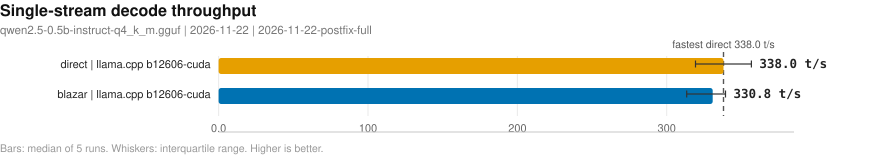

_Median decode t/s per runtime and engine; whiskers span the interquartile range of the 5 runs; the dashed line marks the fastest direct engine. Higher is better. Source: 2026-11-22-postfix-full/cells.jsonl._

### Gateway overhead (chart)

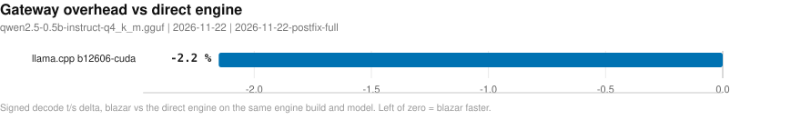

_Decode t/s delta of routing through blazar relative to driving the same engine build directly; left of zero means the gateway path won. Source: 2026-11-22-postfix-full/cells.jsonl._

### Concurrency scaling (chart)

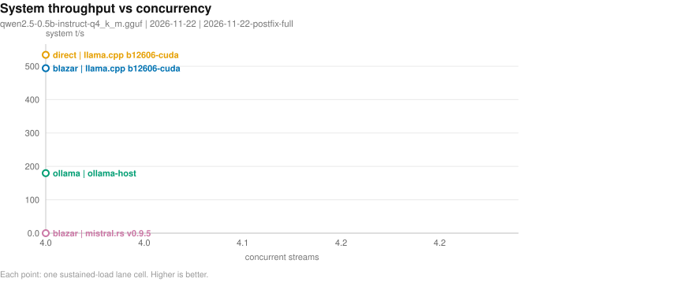

_Aggregate system tokens/s as parallel streams are added; flat-to-rising means the scheduler keeps the device saturated. Higher is better. Source: 2026-11-22-postfix-full/cells.jsonl._

### Concurrency tail latency (chart)

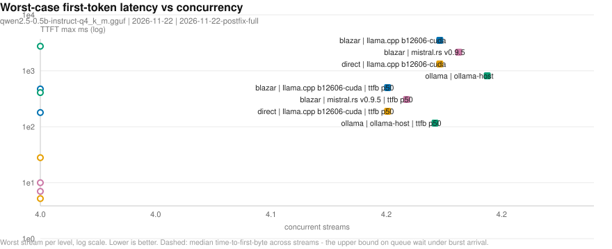

_Worst-case first-token wait per stream as concurrency rises (log scale) - the tail the scheduler must bound. Lower is better. Dashed curves carry the median time-to-first-byte, which upper-bounds queue wait under burst arrival. Source: 2026-11-22-postfix-full/cells.jsonl._

### Resource cost vs concurrency (chart)

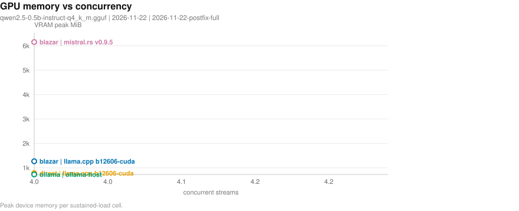

_Peak VRAM footprint as parallel streams (and their KV caches) stack up. Source: 2026-11-22-postfix-full/cells.jsonl._

### Resource cost vs concurrency (chart)

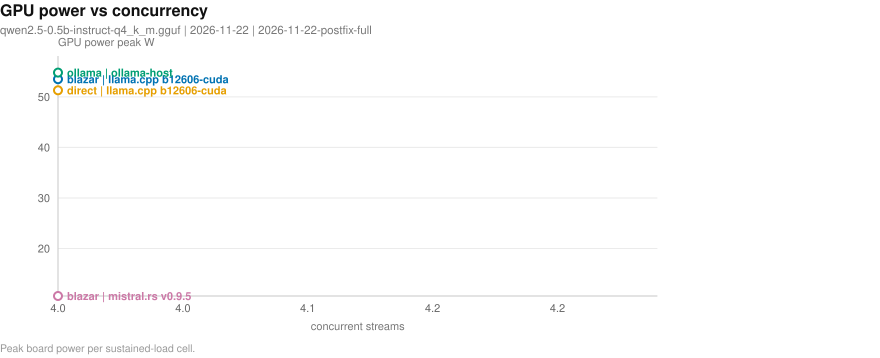

_Peak GPU board power per concurrency level - the energy price of keeping the device saturated. Source: 2026-11-22-postfix-full/cells.jsonl._

### Long-context degradation (chart)

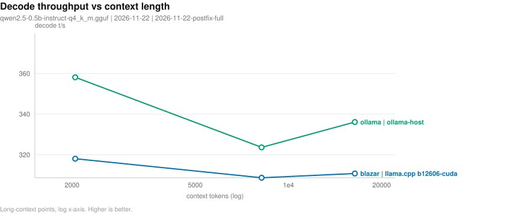

_Single-stream decode t/s as prompt context grows (log x-axis) - KV-cache pressure made visible. Source: 2026-11-22-postfix-full/cells.jsonl._

### Memory vs context (chart)

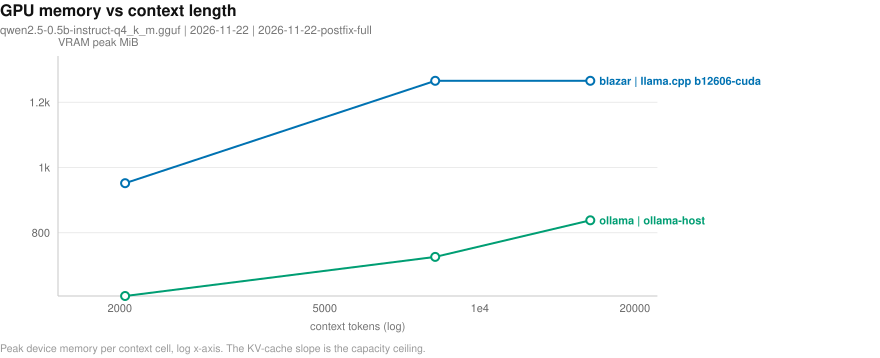

_Peak VRAM as prompt context grows (log x-axis) - the KV-cache slope that sets the usable context ceiling. Source: 2026-11-22-postfix-full/cells.jsonl._

### Lifecycle: cold start and idle wake (chart)

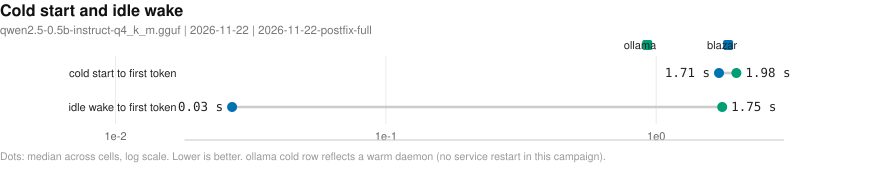

_Seconds to first token after a cold start (page cache dropped) and after idle-policy expiry; blazar keeps weights resident while ollama reloads from disk. Warm-daemon ollama caveat applies. Lower is better. Source: 2026-11-22-postfix-full/cells.jsonl._

### Quality suites (chart)

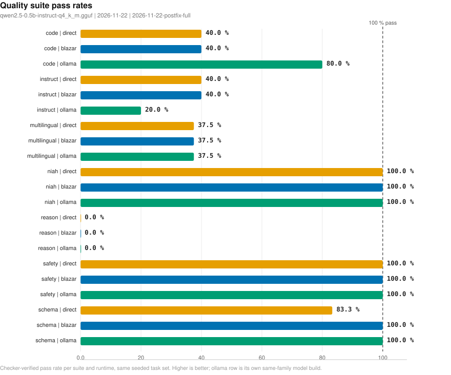

_Deterministic-checker pass rates per suite (reasoning, instruction following, code, schema, needle-in-haystack, multilingual, safety) across runtimes on the identical seeded task set. Source: 2026-11-22-postfix-full/cells.jsonl._

### Gateway quality parity (chart)

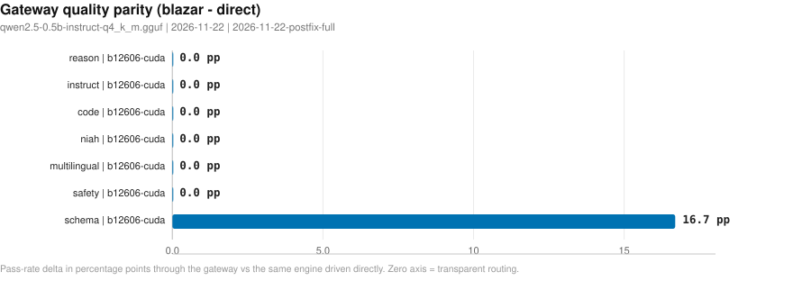

_Per-suite pass-rate delta of routing through blazar vs the same engine build driven directly; bars hugging the zero axis are the gateway being output-transparent. Source: 2026-11-22-postfix-full/cells.jsonl._

### KV-quant perplexity (chart)

_Perplexity per KV-cache quantization configuration (whiskers: standard error); the dashed line marks the unquantized f16 run. Lower is better; compare only within one context rung. Source: 2026-11-22-postfix-full/cells.jsonl._

## Speed (single-stream, medians)

| engine | provider | params | n | ttft p50 (ms) | ttft p99 (ms) | itl p99 (ms) | decode t/s | prefill t/s (cached) | VRAM peak (MiB) |
|---||---||---||---||---||---||---||---||---||
| b12606-cuda | blazar | config=cache_q8_q8_0 child: np=2 ctx=32768 | 1 | 8 | 12 | 5 | 306.5 | 65175.8 | 1100 |
| b12606-cuda | blazar | config=cache_reuse_256 child: np=2 ctx=32768 | 1 | 7 | 10 | 5 | 317.8 | 73718.4 | 1266 |
| b12606-cuda | blazar | config=cont_batching_off child: np=2 ctx=32768 | 1 | 7 | 10 | 4 | 326.4 | 66825.6 | 1266 |
| b12606-cuda | blazar | config=ctx_checkpoints_4 child: np=2 ctx=32768 | 1 | 8 | 10 | 4 | 325.8 | 68548.1 | 1266 |
| b12606-cuda | blazar | config=default child: np=2 ctx=32768 | 1 | 8 | 10 | 4 | 330.8 | 73216.2 | 1266 |
| b12606-cuda | blazar | config=deterministic_on child: np=1 ctx=16384 | 1 | 7 | 10 | 4 | 331.9 | 79680.3 | 1056 |
| b12606-cuda | blazar | config=fa_off child: np=2 ctx=32768 | 1 | 9 | 14 | 5 | 326.9 | 72284.2 | 1922 |
| b12606-cuda | blazar | config=fa_on child: np=2 ctx=32768 | 1 | 8 | 11 | 4 | 335.5 | 74820.8 | 1266 |
| b12606-cuda | blazar | config=kv_unified_off child: np=2 ctx=32768 | 1 | 9 | 10 | 4 | 330.5 | 72929.4 | 1248 |
| b12606-cuda | blazar | config=kv_unified_on child: np=2 ctx=32768 | 1 | 8 | 11 | 5 | 322.0 | 74536.1 | 1266 |
| b12606-cuda | blazar | config=kv_unified_per_slot_4096 child: np=2 ctx=32768 | 1 | 8 | 11 | 5 | 341.1 | 74244.3 | 1266 |
| b12606-cuda | blazar | config=mmproj_offload_off child: np=2 ctx=32768 | 1 | 8 | 11 | 4 | 320.6 | 75692.3 | 1266 |
| b12606-cuda | blazar | config=no_kv_offload_on child: np=2 ctx=32768 | 1 | 9 | 14 | 7 | 192.8 | 52536.2 | 856 |
| b12606-cuda | blazar | config=single-stream child: np=1 ctx=16384 | 1 | 8 | 10 | 4 | 326.8 | 69374.3 | 1056 |
| b12606-cuda | blazar | config=spec_off child: np=2 ctx=32768 | 1 | 7 | 11 | 4 | 346.9 | 82902.9 | 1266 |
| b12606-cuda | blazar | config=swa_full_on child: np=2 ctx=32768 | 1 | 8 | 10 | 5 | 327.5 | 66514.2 | 1266 |
| b12606-cuda | blazar | config=threads_batch_8 child: np=2 ctx=32768 | 1 | 7 | 9 | 5 | 324.2 | 74418.9 | 1266 |
| b12606-cuda | ctxcurve-blazar | ctx=16384 child: np=2 ctx=32768 | 1 | 9 | 14 | 5 | 310.8 | 73821.4 | 1266 |
| b12606-cuda | ctxcurve-blazar | ctx=2048 child: np=4 ctx=8192 | 1 | 8 | 14 | 4 | 318.1 | 76385.2 | 952 |
| b12606-cuda | ctxcurve-blazar | ctx=8192 child: np=4 ctx=32768 | 1 | 9 | 14 | 5 | 308.7 | 70350.7 | 1266 |
| b12606-cuda | direct | ctx=16384 np=1 | 1 | 6 | 10 | 4 | 338.0 | 91594.3 | 788 |
| b12606-cuda | direct | ctx=16384 np=4 | 1 | 6 | 11 | 4 | 332.5 | 84445.7 | 776 |
| b12606-cuda | direct | ctx=4096 np=1 | 1 | 6 | 11 | 4 | 358.9 | 88038.2 | 632 |
| b12606-cuda | direct | ctx=4096 np=1 kv=q8_0 | 1 | 6 | 12 | 4 | 325.7 | 81796.4 | 616 |
| b12606-cuda | direct | ctx=4096 np=1 pa=on | 1 | 6 | 11 | 4 | 355.1 | 83484.9 | 632 |
| b12606-cuda | direct | ctx=4096 np=1 spec=ngram-simple | 1 | 6 | 11 | 4 | 333.6 | 82954.4 | 632 |
| b12606-cuda | direct | ctx=4096 np=4 | 1 | 6 | 11 | 4 | 356.4 | 87433.8 | 630 |
| ollama-host | ctxcurve-ollama | ctx=16384 | 1 | 16 | - | - | 336.1 | - | 838 |
| ollama-host | ctxcurve-ollama | ctx=2048 | 1 | 16 | - | - | 358.1 | - | 606 |
| ollama-host | ctxcurve-ollama | ctx=8192 | 1 | 17 | - | - | 323.6 | - | 726 |
| ollama-host | ollama | reference=True NOTE: serves 'qwen2.5:0.5b' - t/s NOT comparable | 1 | 9 | 12 | 4 | 341.0 | 123427.2 | 726 |
| v0.9.5 | blazar | config=default child: ctx=16384 | 1 | 9 | 10 | - | 0.0 | - | 6174 |
| v0.9.5 | blazar | config=deterministic_on child: ctx=16384 | 1 | 6 | 9 | - | 0.0 | - | 6176 |
| v0.9.5 | blazar | config=kv_unified_off child: ctx=16384 | 1 | 5 | 6 | - | 0.0 | - | 6198 |
| v0.9.5 | blazar | config=kv_unified_on child: ctx=16384 | 1 | 5 | 6 | - | 0.0 | - | 6176 |
| v0.9.5 | blazar | config=mr_enc_cache_512mb child: ctx=16384 | 1 | 4 | 5 | - | 0.0 | - | 6176 |
| v0.9.5 | blazar | config=mr_prefix_cache_256 child: ctx=16384 | 1 | 6 | 7 | - | 0.0 | - | 6184 |
| v0.9.5 | blazar | config=pa_mem_0.55 child: ctx=16384 | 1 | 6 | 9 | - | 0.0 | - | 3968 |
| v0.9.5 | blazar | config=pa_mem_0.85 child: ctx=16384 | 1 | 3 | 5 | - | 0.0 | - | 6370 |
| v0.9.5 | blazar | config=paged_attn_off child: ctx=16384 | 1 | 11 | 18 | 6 | 245.6 | 20555.5 | 806 |
| v0.9.5 | blazar | config=single-stream child: ctx=16384 | 1 | 7 | 11 | - | 0.0 | - | 6180 |
| v0.9.5 | blazar | config=spec_off child: ctx=16384 | 1 | 3 | 6 | - | 0.0 | - | 6184 |
| v0.9.5 | ctxcurve-blazar | ctx=16384 child: ctx=16384 | 1 | 4 | 9 | - | 0.0 | - | 6176 |
| v0.9.5 | ctxcurve-blazar | ctx=2048 child: ctx=2048 | 1 | 4 | 4 | - | 0.0 | - | 6176 |
| v0.9.5 | ctxcurve-blazar | ctx=8192 child: ctx=8192 | 1 | 8 | 9 | - | 0.0 | - | 6176 |

## Concurrency (parallel streams, medians)

| provider | engine | params | n | sys t/s | ttft max (ms) | itl p99 (ms) | ok/errors |
|---||---||---||---||---||---||---||---||
| blazar | b12606-cuda | config=adaptive_slots_off conc=8 | 1 | 344.2 | 2690 | 5 | 16/0 |
| blazar | b12606-cuda | config=conc_default conc=8 | 1 | 344.8 | 2938 | 5 | 16/0 |
| blazar | b12606-cuda | config=poll_50 conc=8 | 1 | 325.6 | 3009 | 5 | 16/0 |
| conc-blazar | b12606-cuda | conc=4 rounds=3 | 1 | 493.9 | 474 | 6 | 12/0 |
| conc-blazar | v0.9.5 | conc=4 rounds=3 | 1 | 0.0 | 10 | - | 12/0 |
| conc-direct | b12606-cuda | conc=4 rounds=3 | 1 | 534.1 | 28 | 8 | 12/0 |
| conc-ollama | ollama-host | conc=4 rounds=3 | 1 | 179.9 | 2752 | 4 | 12/0 |
- sys t/s = total tokens / wall (true system throughput); flat sys t/s with growing ttft max means streams queued on a fixed slot count instead of being served concurrently.

## Quality - perplexity (identical pinned args)

| engine | perplexity | +/- err | wall (s) | note |
|---|---|---|---|---|
| b12606-cuda | 33.5528 | 1.90236 | 2.4 | lower = better text fit |
| v0.9.5 | 33.5528 | 1.90236 | 2.3 | lower = better text fit |
- corpus: deterministic offline repo text (code-heavy) - PARITY-ONLY; absolute PPL is not comparable to published wiki-text perplexities.

## Quality - greedy parity vs `b12606-cuda`-direct (backend numerics)

| engine | exact matches | ratio mean | ratio min | first divergence (median chars) |
|---|---|---|---|---|
| b12606-cuda *(self - trivially 1.0) | 20/20 | 1.0 | 1.0 | 988.0 |
| v0.9.5 | -/- | - | - | - |

## Quality - gateway transparency (blazar path vs direct, same engine)

| engine | exact matches | ratio mean | ratio min | first divergence (median chars) |
|---|---|---|---|---|
| b12606-cuda | 5/20 | 0.4855 | 0.0269 | 134.0 |
- expectation: 20/20 exact, ratio 1.0. A miss has TWO possible causes: gateway translation defect (sampler remap / template drift), or multi-slot batching numerics (child -np > 1 changes float reduction order; near-tie logits flip). Pin `slots = 1` and re-run: still <20/20 = translation defect, 20/20 = slot-count numerics (upstream physics).
## Feature matrix

| feature | b12606-cuda | v0.9.5 | ollama(documented) |
|---|---|---|---|
| `anthropic-api` | - | Y | - |
| `ctx-override` | Y | Y | Y |
| `embeddings` | Y | - | Y |
| `grammar-gbnf` | Y | - | - |
| `json-schema` | Y | Y | Y |
| `kv-quant` | Y | Y | - |
| `lora-adapter` | Y | Y | Y |
| `metrics-endpoint` | Y | Y | - |
| `paged-attn` | Y | Y | - |
| `parallel-np` | Y | Y | Y |
| `quant-on-load` | Y | Y | - |
| `rerank` | Y | - | - |
| `slots-sessions` | Y | - | - |
| `spec-decode` | Y | Y | - |
| `tokenize-endpoint` | Y | - | Y |
| `vision-mmproj` | Y | Y | Y |

## Failed cells

**product** (engine/gateway behavior):

- `v0.9.5` / direct (5 cells): child exited rc=1 during load; last output: Error: multimodal GGUF architecture `qwen2` is not supported by the native multimodal loader | [{'ctx': 4096, 'np': 1}; {'ctx': 4096, 'np': 4}; {'ctx': 16384, 'np': 1}; {'ctx': 16384, 'np': 4}; +1 more]
- `v0.9.5` / blazar (10 cells): zero tokens served (model failed to load/serve) [{'config': 'default'}; {'config': 'single-stream'}; {'config': 'kv_unified_on'}; {'config': 'kv_unified_off'}; +6 more]
- `v0.9.5` / ctxcurve-blazar (3 cells): zero tokens served (model failed to load/serve) [{'ctx': 2048}; {'ctx': 8192}; {'ctx': 16384}]
- `v0.9.5` / greedy / {'greedy': True}: child failed to become healthy; stderr tail: 'Error: multimodal GGUF architecture `qwen2` is not supported by the native multimodal loader\n'
- `v0.9.5` / quality / {'config': 'default'}: quality lanes: first task transport failure (reason/reason-0: HTTP Error 503: Service Unavailable)
- `v0.9.5` / quality-direct / {'config': 'direct'}: child failed to become healthy; stderr tail: 'Error: multimodal GGUF architecture `qwen2` is not supported by the native multimodal loader\n'

## Reading this report

- `direct` = raw child spawn on a probed free port (no gateway); `blazar` = full gateway path inside a sandboxed daemon (resolved engine argv in `child_argv`); `ollama` = HTTP-only reference against the host service.
- decode counts ALL emitted tokens (content + reasoning); engine `usage` counters are authoritative when present. GPU/power peaks sampled at ~1.2 s cadence.
- per-run spread, cold-start/resource detail, and every raw cell live in `cells.jsonl`; tables here are per-config medians.
